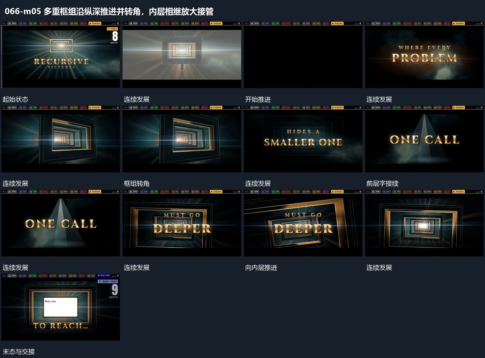

# 多重框组沿纵深推进并转角，内层相继放大接管

## 运动指令

沿多重框组的纵深向前推进，同时改变观察角度。前层框相继放大越过边缘，后层框转正接管中央，直到末层平面成为主要承载，附属字随后补齐。

## 视频切片

[播放本机制的原片切片](m05.mp4)

保留起始准备、连续发展和完成或明确交接；首尾按本段运动范围裁切，不拼接、不变速。尾部只保留理解结果所需的展示。

## 分镜过程

## 组合与调整

每层要共享清楚的空间轴，转角不应让下一层突然跳到无关位置。
