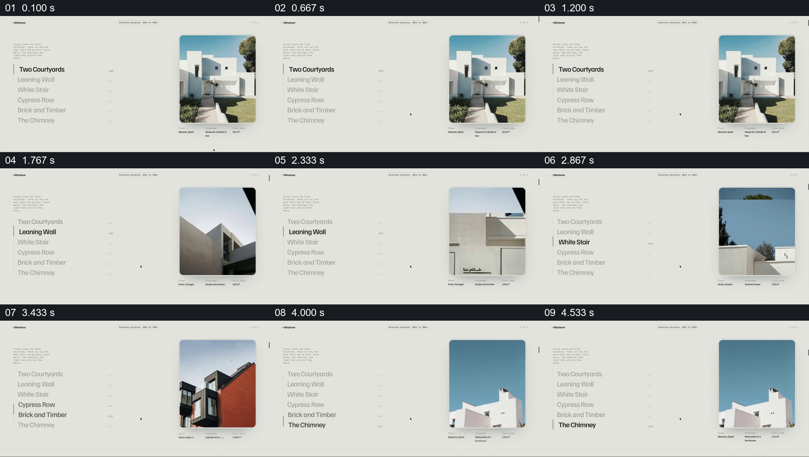

# 让左侧建筑目录与右侧照片保持一对一切换

- 作品：案例 018《滚动网页中的建筑、路线与色样展示》（库内索引名）。
- 原片范围：00:00.000–00:05.000，含起点、不含终点；[完整原片](../video.mp4)｜[本卡片段](c01.mp4)，片段起点对应原片 0.000 秒。
- 范围依据：名称、照片和资料同步更替共同构成一个目录交互。
- 观察方式：核看全片 64 帧总览及本卡九宫格；未独立连续原速观看，快速变化和运动节奏待核。原片无音轨。片中事实和演示未独立查证，新题材迁移尚未实测。

## 原画面具体怎样设计

浅灰页面左侧竖排建筑名称，当前行加深并有竖线标记，其他名称变浅；右侧固定圆角竖幅照片，下方是地点、用途及面积。随后名称焦点向下改变，照片画框内出现下一处建筑，画面间可见上下分割的中间状态；下方小字随选中项变化。

## 为什么这样设计，好在哪里

名单提供稳定导航，照片是选中条目的具体内容；两者同时改变使读者知道当前图对应哪一行。若仅轮播照片，项目与图像的对应需要另寻；页面只是作品展示，并不证明项目资料。

## 可直接使用的创意指令

准备每个项目的准确名称、图片与必要资料；让列表和视觉窗口保持固定空间，选中项变化时更新对应图片与资料，其他行保持次级可见。数量、切换方式和版式可改；关键是一项名称始终对应一项实际素材。
