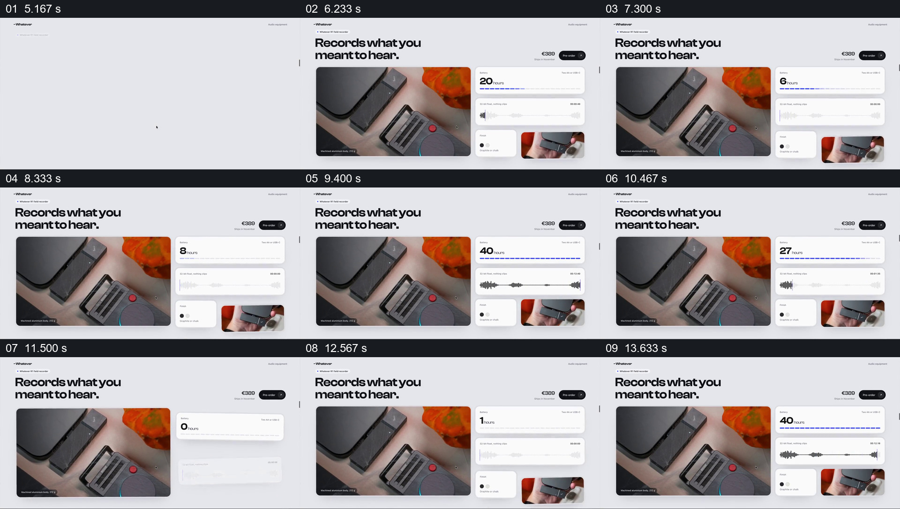

# 让录音设备图像与状态组件在同一页面并置

- 作品：案例 018《滚动网页中的建筑、路线与色样展示》（库内索引名）。
- 原片范围：00:05.000–00:14.500，含起点、不含终点；[完整原片](../video.mp4)｜[本卡片段](c02.mp4)，片段起点对应原片 5.000 秒。
- 范围依据：同一设备与多项状态共同展示产品；之后转为旅程页面。
- 观察方式：核看全片 64 帧总览及本卡九宫格；未独立连续原速观看，快速变化和运动节奏待核。原片无音轨。片中事实和演示未独立查证，新题材迁移尚未实测。

## 原画面具体怎样设计

浅色产品页左上为“Records what you meant to hear”，左下大图显示录音设备和红色按键；右侧上方是小时数与蓝色电量条，中间为波形卡，下方并列颜色选项和手持设备局部图。不同源帧里小时数、条形和波形先后变化，左侧设备大图与标题持续留在原位。

## 为什么这样设计，好在哪里

设备照片为各状态提供稳定主体，分离的小卡避免把性能、录音和外观混在图上。不同数值状态可被比较，但抽帧无法证明电量与波形同步或代表真实测试；片中价格及指标亦未经核实。

## 可直接使用的创意指令

选一个能辨认的设备或产品主图，让与其相关但单位不同的属性分置独立卡片；展示状态变化时保持主体与标签可读，并使用真实数据或明确模拟。布局、卡片和颜色可变；保持每项状态的对象与单位。
