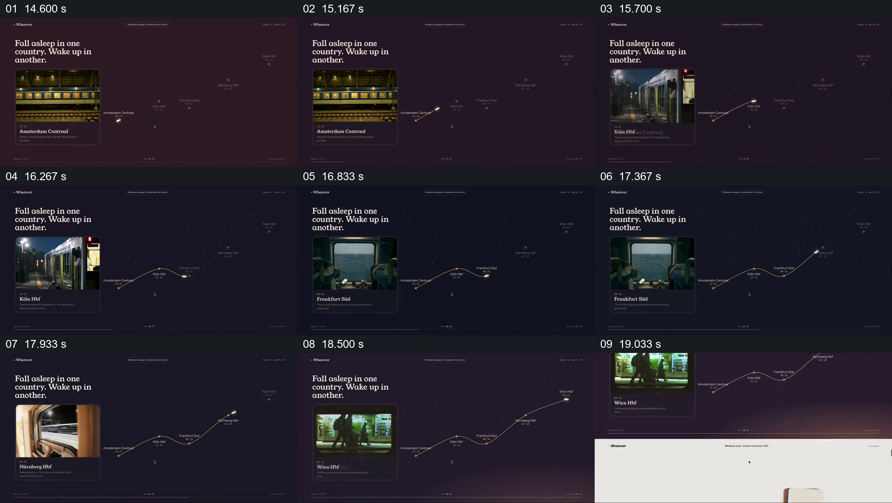

# 让路线位置与左侧影像卡交接同一次旅程

- 作品：案例 018《滚动网页中的建筑、路线与色样展示》（库内索引名）。
- 原片范围：00:14.500–00:19.500，含起点、不含终点；[完整原片](../video.mp4)｜[本卡片段](c03.mp4)，片段起点对应原片 14.500 秒。
- 范围依据：路线进展和影像卡共同完成一段旅程。
- 观察方式：核看全片 64 帧总览及本卡九宫格；未独立连续原速观看，快速变化和运动节奏待核。原片无音轨。片中事实和演示未独立查证，新题材迁移尚未实测。

## 原画面具体怎样设计

深紫色页面左上写“Fall asleep in one country. Wake up in another.”，左下照片卡展示阿姆斯特丹车站；右侧细路线连接 Köln、Frankfurt、Nürnberg、Wien 等站点。后续源帧中路线点亮位置改变，左侧卡片依次改为站台、车内、窗景及维也纳，地点和时间随卡片更新。

## 为什么这样设计，好在哪里

路线把分散地点组织为同一次旅程，照片卡让当前站点有具体画面；地图和照片分别承担全局位置与局部感受。若只切换照片，顺序不易追踪；实际路线、时间和素材归属尚未核实。

## 可直接使用的创意指令

对可核实的路线准备站点顺序、时间和对应影像；保留总体路线作为参照，让当前站点成为焦点，同时更新独立的局部画面与标签。线路形状和画幅可以调整，关键是当前影像与实际站点对应。
