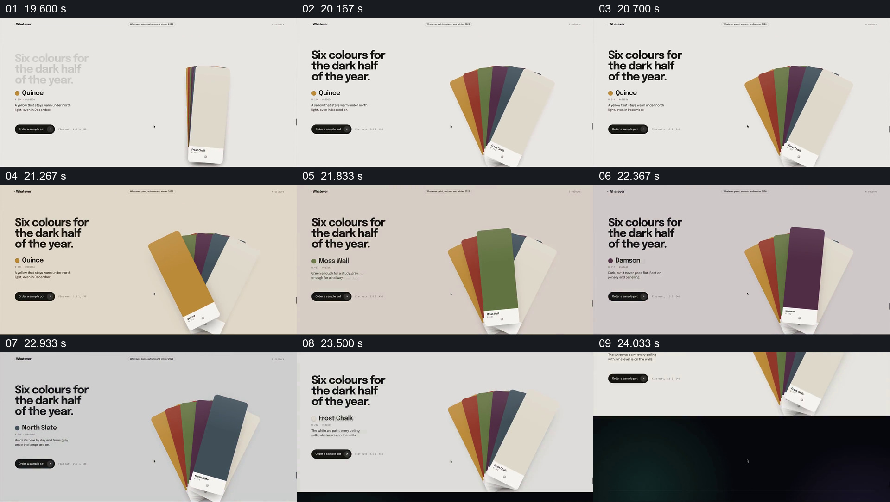

# 用同一组扇形色卡逐一比较颜色

- 作品：案例 018《滚动网页中的建筑、路线与色样展示》（索引名称）。
- 原片范围：00:19.500–00:24.500，含起点、不含终点；[完整原片](../video.mp4)｜[本卡片段](c04.mp4)。
- 观察方式：依据原片 64 宫格和约每秒真实源帧观察；未连续原速观看，媒体探测显示原片没有音轨。

## 原画面具体怎样设计

浅色页面左侧写“Six colours for the dark half of the year.”，右侧六张色卡呈扇形展开。画面依次突出黄色、绿色和深蓝色卡，左侧相应颜色名称变化，其他色卡留在后面。

## 为什么这样设计，好在哪里

一次把一张色卡放到前景，既保留整组可比较的范围，也清楚标出当前讲的是哪一种。实物或屏幕色彩受拍摄和显示影响，画面不能直接证明精确色值。

以上为依据画面的分析，非作者自述；预期观看效果未经观众测试。

## 可直接使用的创意指令

当需要展示一组可比较的样品时，将它们以可同时辨认的队列或扇形排列，让当前样品移到前景并与名称、必要说明对应，随后切到下一项而保留整组参照。若颜色或材料精度重要，提供真实样品与标准数据，不以视频画面代替。
