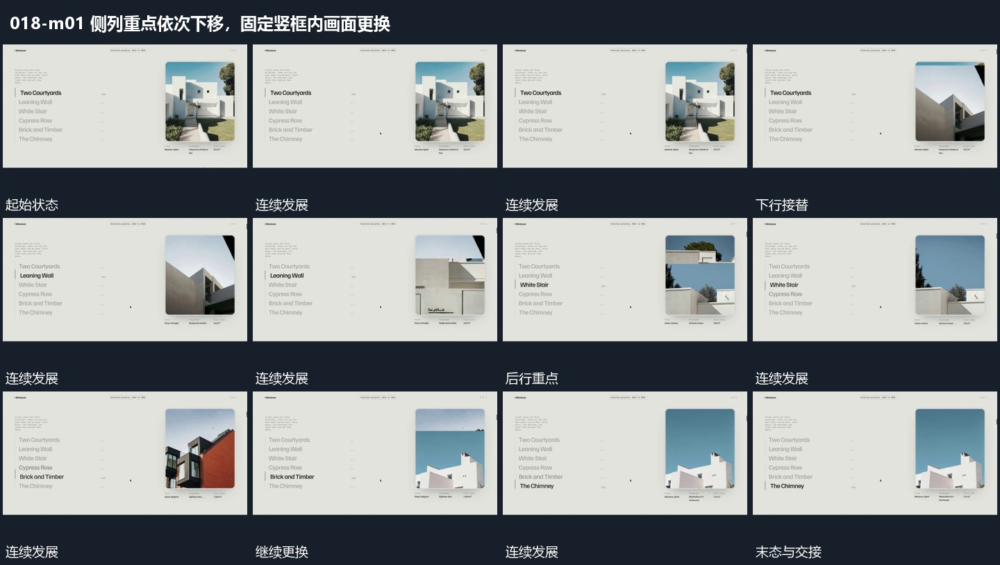

# 侧列重点依次下移，固定竖框内画面更换

## 运动指令

保留左侧纵列和右侧竖框，当前行逐次向下变化，框内同时接续换入对应图像。非当前行退淡，外框与列表间距不变，最后整组向上退出。

## 视频切片

[播放本机制的原片切片](m01.mp4)

覆盖分镜中“首行”至“末行”的连续过程，并保留邻近的前后衔接画面；原片中交叠发生的动作一并保留。

## 分镜过程

## 组合与调整

可改变行数，保留同一参照；换图不必让外框重新进出。
