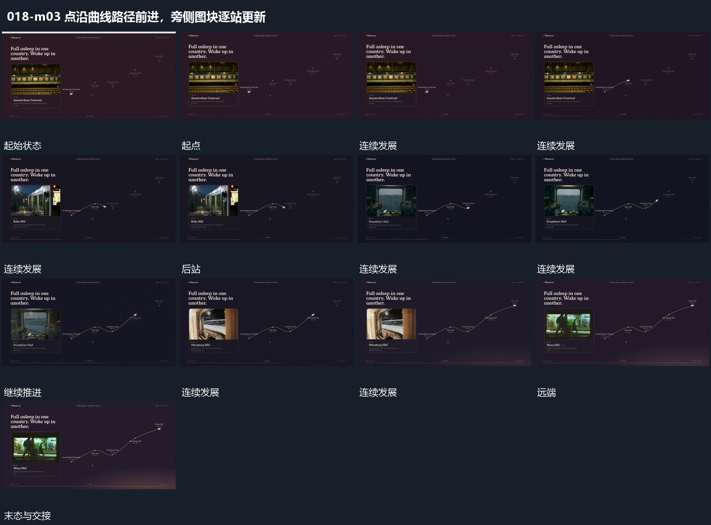

# 点沿曲线路径前进，旁侧图块逐站更新

## 运动指令

沿曲线向前推进亮点，已走过路径留住。旁侧图块按阶段更换内部内容和短行，曲线范围逐渐显出更多后段，顶部字保持。

## 视频切片

[播放本机制的原片切片](m03.mp4)

保留起始准备、连续发展和完成或明确交接；首尾按本段运动范围裁切，不拼接、不变速。尾部只保留理解结果所需的展示。

## 分镜过程

## 组合与调整

可改路径形状，站点对应在新片另定，不能只换图而路径毫无接续。
