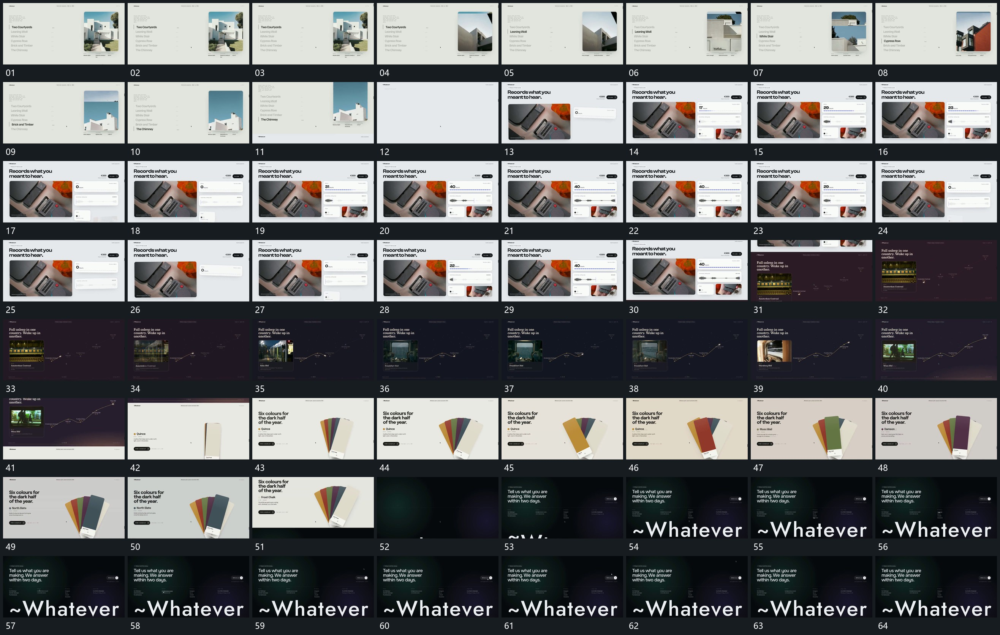

# 018｜原片运动总览

[观看完整原片](video.mp4)

## 运动总览

开头 侧列重点依次下移，固定竖框内画面更换 保留固定竖框与侧方文字列，当前行变化时框内图像接续更新。整组上退后建立新的大框与侧面板，面板内数字增减，波形与短条同步更新 让数字、细条及波形在固定边界中往复变化。

接着旧组上移露出新底，点沿曲线路径前进，旁侧图块逐站更新 从一侧建立图块与曲线路径，点沿路径前进，图块内部随阶段更换。随后 同轴片层扇开，各片先后向前突出 展开同轴片层，在固定扇形集合中突出不同片面。末段新底层和字组建立，下方大字向上露出后保持。

## 完整运动段落

以下按原片中的出现顺序引用。建立、内部发展及完成反馈放在同一段中；同时发生的局部动作与运镜写在同一份指令里。不同段之间可以是连续接管，也可以是直接切换，不能仅凭条目相邻认定可直接拼接。重复出现的同类运动采用一次连续代表范围，切片不以逐段无缝覆盖整片为目标。

1. [侧列重点依次下移，固定竖框内画面更换](mechanisms/m01.md)：重点沿行移动，外框不跟随

2. [面板内数字增减，波形与短条同步更新](mechanisms/m02.md)：框边固定，变化局限在内部

3. [点沿曲线路径前进，旁侧图块逐站更新](mechanisms/m03.md)：旧路径保留，移动点引导局部换图

4. [同轴片层扇开，各片先后向前突出](mechanisms/m04.md)：共同轴固定，选中片从原角度前移

切片保留起始准备、必要内部停顿和完成或明确交接；首尾省略无新发展的等待，持续运动不要求人为停住。以上基于真实源帧序列和重点边界核对，不等同于全片连续声画审片。

## 完整64宫格

