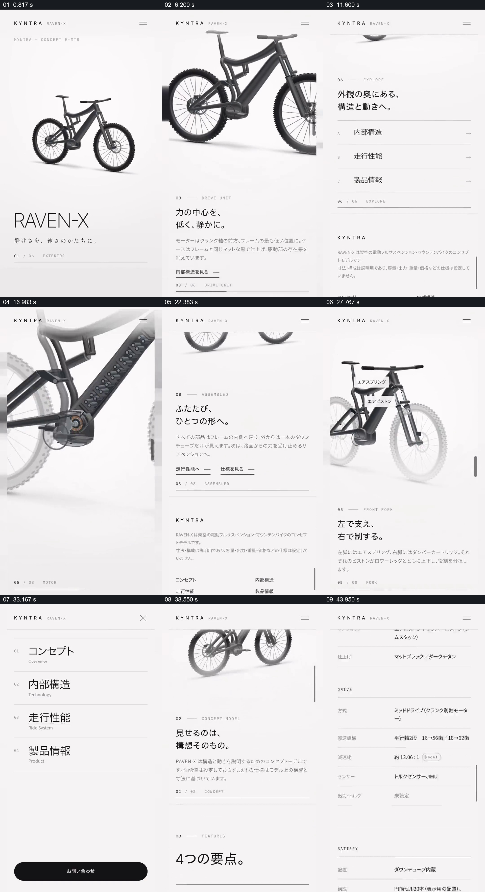

# 围绕同一产品反复往返整体、结构细节与说明

- 作品：案例 090《自行车产品页面的整体与局部》（本次概括）。
- 原片范围：00:00.000–00:48.517，含起点、不含终点；[完整原片](../video.mp4)｜[本卡片段](../video.mp4)。
- 观察方式：依据约每秒一次的真实源帧观察，未连续原速观看或听审；声音、语气与完整播放节奏未确认。

## 原画面具体怎样设计

竖向网页先显示完整自行车与名称；随着页面内容变化，自行车逐渐放大并转动视角，旁边出现分段文字。页面回到整体后，再放大车架和传动附近，以半透明或拆解形式显示内部结构并配标签；后段继续在整体与局部之间切换，随后出现四个要点、规格表和联系表单。

## 为什么这样设计，好在哪里

同一产品形象不断重现，使局部说明可以回到整体定位；细节旁的短标签将观察位置与文字连接，末尾规格和表单则承接介绍后的查阅与行动。内部图形与规格为页面所示，未经实物验证。

以上为依据画面的分析，非作者自述；预期观看效果未经观众测试。

## 可直接使用的创意指令

介绍结构复杂的产品时，先给出可识别的完整外观，再按实际信息需要放大部件，用标签说明其位置和作用；每个局部之后返回整体或保留方位参照，最后提供经核实的规格和下一步入口。透视、剖切与文字应准确对应真实产品。
