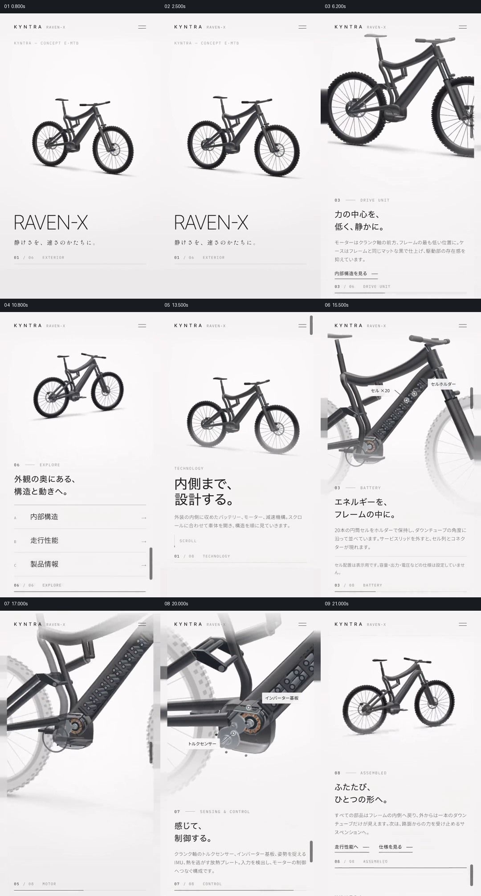

# 先认识整车，再逐层显露车架内部并回到整车

- 作品：案例 090。
- 原片范围：00:00.000–00:22.700（源时间，起点包含、终点不包含）；[完整原片](../video.mp4)｜[本卡片段](c01-20261111.mp4)。该原片无音轨；画面范围按完整表达重新划分，片段与分镜取自完整原片。
- 观察方式与未确认范围：查看完整原片 64 帧总览和本卡分镜；案例 090 的 20–34 秒另按 0.5 秒抽帧核对。未独立连续原速观看及听审，采样间动作、精确速度、声音与同步未确认；以下价值判断为作品分析，迁移尚未实测。

## 原画面具体怎样设计

竖屏暖白页面顶部持续显示 KYNTRA、型号和菜单。黑色自行车先在大面积留白中完整出现，下方是“RAVEN-X”和简短说明；页面往后浏览时，整车变大并局部越过左右边界，下方章节文字跟着改变，先后指向车身线条、驱动部分和细节。车身仍是上方主要对象，文字在下方承担解释，不与模型争夺同一位置。

约 00:11，整车缩小，页面给出内部结构、行驶性能、产品信息等入口；之后再次以完整车身建立“内部结构”章节。约 00:15，车架主梁、下方驱动部分变成更近的观察对象，部分外壳不再遮挡内部，能看见排列的圆柱形电池及圆形机构；文字标签附着对应部位，左右轮和车架轮廓保留为位置参照。随后同一区域继续显示电池组、电机、齿轮和传感器等说明，观察距离及标注随部位变化。约 00:20.5，内部部件退回，完整自行车重新出现，下方显示组装状态和指向后续章节的入口。

## 为什么这样设计，好在哪里

原片先给出能识别的整车，再把观察范围收紧到车架和驱动处；内部示意并没有脱离车架单独悬浮，车轮、管材轮廓和固定的页面顶部帮助观众判断部件位于整车哪里。若直接出现齿轮和电池特写，细节虽清楚，却需要另行解释它们属于哪台设备、处于什么位置。

内部内容按部位轮流成为主角，页面文字随之改变，最后回到整车，相当于把局部发现重新装回一个整体。页面本身明确称这是概念模型，不能将其尺寸、性能或构造当成已验证的实车数据。

## 可直接使用的创意指令

需要解释复杂产品时，先准备可准确识别的整体视图和可信的内部资料。以稳定的背景和简单标题建立对象，再选择与当前说明有关的局部进入较近距离；展示内部时保留足以辨认位置的外壳、轮廓或周边结构，并让标签指向具体部件，避免所有部件与文字同时争抢注意。

在解释完局部关系后回到整体，使观众能把每个部件放回对象中的位置。页面式滚动、背景、字号、标记、观察角度和是否使用剖面都可重设；保留“先有整体参照—局部与整体同时可定位—结果回到整体”的关系。没有可信内部结构时使用明确标注的示意，不把猜测剖面作为事实。
