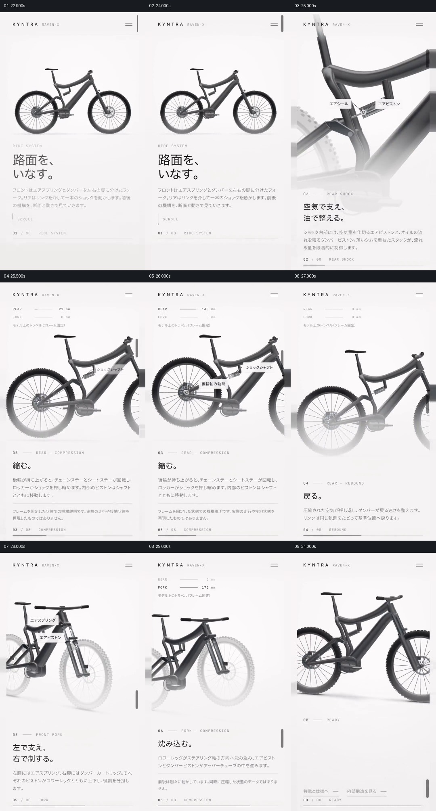

# 让整车作参照，分别展示后部与前部悬架的变化

- 作品：案例 090。
- 原片范围：00:22.600–00:32.700（源时间，起点包含、终点不包含）；[完整原片](../video.mp4)｜[本卡片段](c02-20261111.mp4)。该原片无音轨；画面范围按完整表达重新划分，片段与分镜取自完整原片。
- 观察方式与未确认范围：查看完整原片 64 帧总览和本卡分镜；案例 090 的 20–34 秒另按 0.5 秒抽帧核对。未独立连续原速观看及听审，采样间动作、精确速度、声音与同步未确认；以下价值判断为作品分析，迁移尚未实测。

## 原画面具体怎样设计

约 00:22.6，页面从上一章节的“已组装”结果交到“RIDE SYSTEM”；完整黑色自行车重新出现在暖白页面中，顶部的品牌栏与下方文字位置延续。约 00:25，视野靠近车座下方的后部结构，标签指向零部件；随后后轮及连杆占据较大区域，页面上方出现 REAR、FORK 数值，下方章节分别显示 COMPRESSION 和 REBOUND。

相邻源帧中后轮、连杆与数值呈现不同位置和状态，而主车架仍可辨认；接着视野转到前叉，轮子以较淡的方式留在附近，标签指向前叉内部部件，随后页面显示前叉压缩及回弹的不同状态。约 00:30.5，完整车身重新出现，下方进入“READY”结果；再往后网页转入菜单。

## 为什么这样设计，好在哪里

这段的共同主体是整车；后部和前部被分开观察，是为了在一个阶段内只让一组部件成为焦点。淡化的车轮、仍可辨认的主车架及位置标签提供坐标，而上方的数值与下方状态名帮助区分当前正在展示的变化。

最后回到完整车身，可以把两处局部放回同一设备。片中使用的是概念模型及画面演示；抽帧能比较状态变化，但不能确认精确的压缩曲线、物理正确性或前后动作是否同时发生。

## 可直接使用的创意指令

当一个装置有两组相关但位置不同的运动机构，先展示能够识别二者相对位置的整体，再分别选择局部，让当前观察部件清晰、无关部分退到次要层级。为部件提供可追踪的轮廓或半透明参照，在确有数据时用准确标签和单位说明当前状态；每组变化至少保留基准、变化和结果或回位的可辨时刻。

解释完一处再把注意力交给另一处，最后回到整体。画幅、外观、标签与观察顺序可按材料重设；必须保留部件和整体的相对位置，以及每次变化前后的对应关系。若没有可靠运动模型，只展示已知状态，避免把静态示意冒充经过验证的机械仿真。
