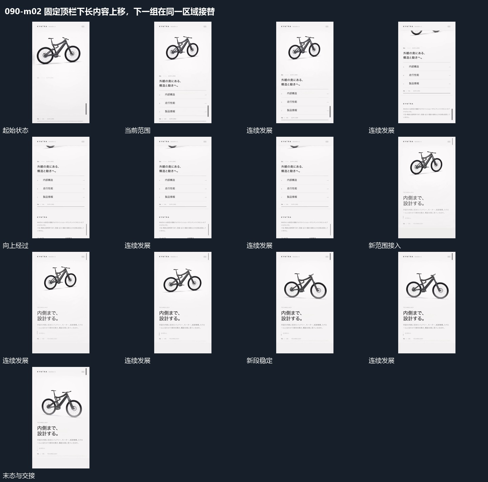

# 固定顶栏下长内容上移，下一组在同一区域接替

## 运动指令

保留顶部窄栏不动，让下方长内容整体向上经过；先把前组送出，再让后组从下方进入同一观看区域。后组的上部图形和下部短行共同落位，停止本轮滚动。

## 视频切片

[播放本机制的原片切片](m02.mp4)

保留起始准备、连续发展和完成或明确交接；首尾按本段运动范围裁切，不拼接、不变速。尾部只保留理解结果所需的展示。

## 分镜过程

## 组合与调整

保留固定边界与内容的相对运动；可改滚动距离，不把后续其他局部演出也包进此片段。
