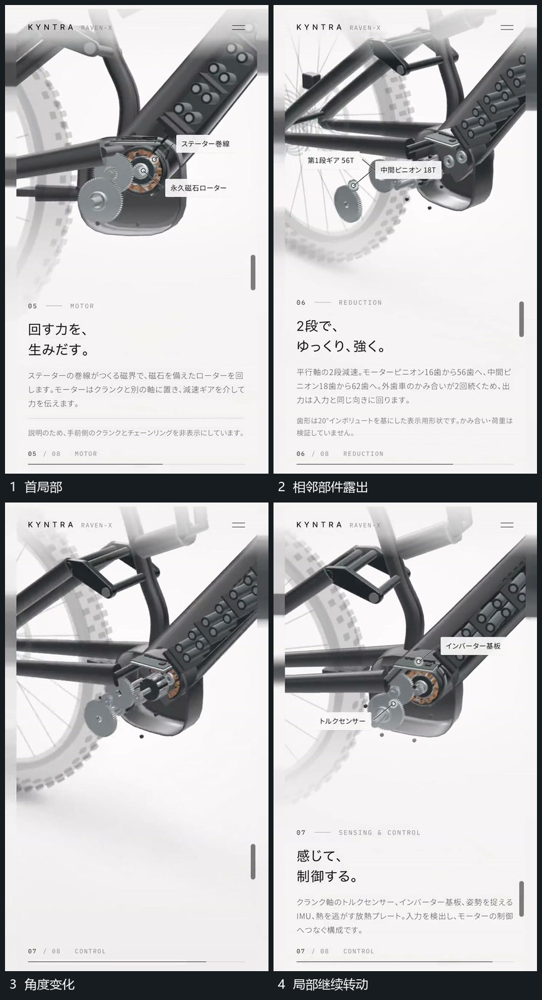

# 相邻圆部件围各自轴转动并保留连接

## 运动指令

保留共同支架和各圆部件轴点，让圆部件围自己的轴改变角度，连接部分保持位于原接点附近。视野可沿连接稍移到相邻部件，但每次先保留旧轴参照，再突出新局部；旁标随局部建立。

## 视频切片

[播放本机制的原片切片](m04.mp4)

覆盖分镜中“首局部”至“局部继续转动”的连续过程，并保留邻近的前后衔接画面；原片中交叠发生的动作一并保留。

## 分镜过程

## 组合与调整

转速和方向按本片需要设计，不声称源帧证明精确传动比或真实物理关系。
