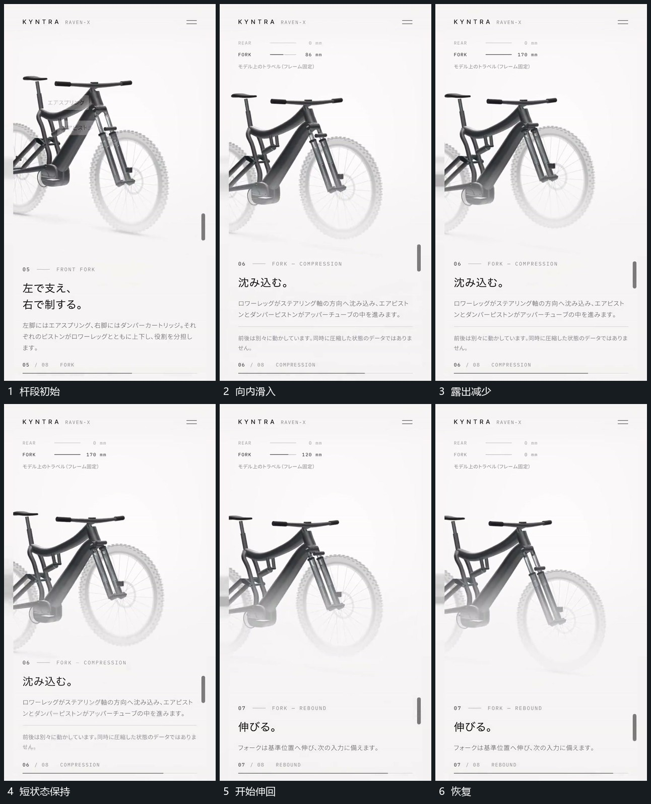

# 杆段沿外套方向滑入再伸回

## 运动指令

固定外套的上端参照，让下部杆段沿外套方向向内滑入，露出长度逐步减少，相连末端圆区随杆段移动。到短状态后反向伸出，恢复原露出长度；旁侧组形保持，不同时改变另一套局部。

## 视频切片

[播放本机制的原片切片](m06.mp4)

覆盖分镜中“杆段初始”至“恢复”的连续过程，并保留邻近的前后衔接画面；原片中交叠发生的动作一并保留。

## 分镜过程

## 组合与调整

轴方向可倾斜；把长度变化和末端位移连起来，避免只缩放整个外套。
