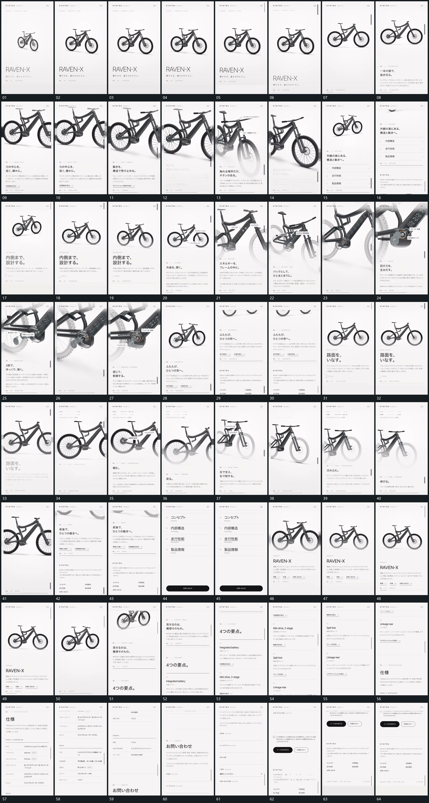

# 090｜原片运动总览

[观看完整原片](video.mp4)

## 运动总览

全片反复以同一复杂组形放大转角再缩回全貌改变同一复杂组形的尺度与观察角度，下方长条内容通过纵向长条连续上移固定顶栏保留连续上移。内部段落用近侧外层退让露出内部并推向局部退让近侧外层，露出内部并推向局部，多个指示从原局部派生。

局部演示依次采用相邻圆部件围各自轴转动并保留连接的共同轴附近转向与部件相对转动、连杆绕接点摆动短杆同时收缩再恢复的连杆绕接点摆动及短杆收缩恢复、杆段沿外套方向滑入再伸回的杆段沿外套方向滑入再伸回。最终组形恢复全貌，纵向长条连续上移固定顶栏保留继续完成多段纵向经过；整列前框接入遮住原组后退回原层在原层上接入整列前框并退回原空间。

## 完整运动段落

以下按原片中的出现顺序引用。建立、内部发展及完成反馈放在同一段中；同时发生的局部动作与运镜写在同一份指令里。不同段之间可以是连续接管，也可以是直接切换，不能仅凭条目相邻认定可直接拼接。重复出现的同类运动采用一次连续代表范围，切片不以逐段无缝覆盖整片为目标。

1. [同一复杂组形放大转角再缩回全貌](mechanisms/m01.md)：尺度变化与转角连续

2. [固定顶栏下长内容上移，下一组在同一区域接替](mechanisms/m02.md)：保留顶部窄栏不动，让下方长内容整体向上经过；先把前组送出，再让后组从下方进入同一观看区域。后组的上部图形和下部短行共同落位，停止本轮滚动。

3. [近侧外层让出内部，推进局部后圆部件同轴转动](mechanisms/m08.md)：外层先退让显出内组，取景推进到局部；相邻圆部件各自绕轴转动，连接仍保持，最后取景回到较完整范围。

4. [连杆绕接点摆动短杆同时收缩再恢复](mechanisms/m05.md)：摆动与收缩交叠

5. [杆段沿外套方向滑入再伸回](mechanisms/m06.md)：轴向滑入后伸出

6. [整列前框接入遮住原组后退回原层](mechanisms/m07.md)：前层覆盖再释放

切片保留起始准备、必要内部停顿和完成或明确交接；首尾省略无新发展的等待，持续运动不要求人为停住。以上基于真实源帧序列和重点边界核对，不等同于全片连续声画审片。

## 完整64宫格

