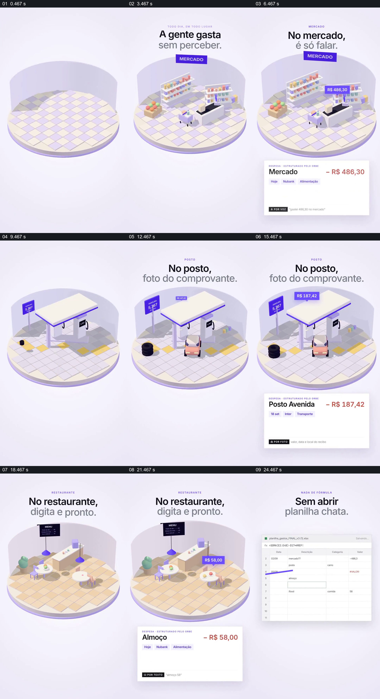

# 让三种地点各自对应一种记账输入，再汇成列表

- 作品：案例 058《不同地点的支出记录》（索引名称）。
- 原片范围：00:00.000–00:27.000，含起点、不含终点；[完整原片](../video.mp4)｜[本卡片段](c01.mp4)。
- 观察方式：依据整片 64 宫格和约每秒一次的真实源帧观察，未连续原速观看或听审；声音、语气与完整播放节奏未确认。

## 原画面具体怎样设计

竖屏浅色背景中微缩超市出现，下方语音波形变为一条金额记录；场景转为加油站，收据照片变成另一条记录；再转到餐厅，文字输入产生午餐记录。最后列表同时列出三笔。

## 为什么这样设计，好在哪里

相同结构重复三次，让场所与输入方式一一对应；最终列表显示它们进入同一个记录结果。未听审语音，识别与金额准确性未核实。

以上为依据画面的分析，非作者自述；预期观看效果未经观众测试。

## 可直接使用的创意指令

当介绍多种录入方式时，选择有代表性的真实或模拟情境，分别展示输入、识别结果和可修改的记录，最后汇总到同一列表；金额和隐私处理依据实际系统核对。
