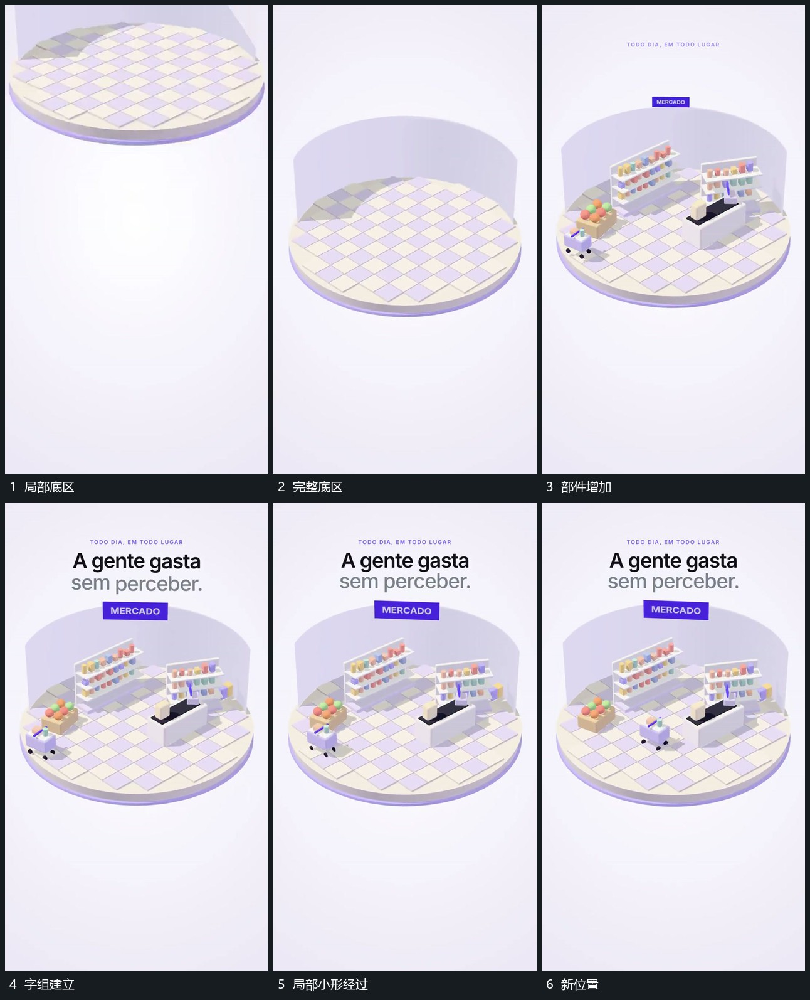

# 圆形底区接入，局部部件逐项建立，小形在内经过

## 运动指令

接入圆形底区，先稳定其尺度与位置，再逐项补入局部部件。各部件落稳后小形沿底区内部路径经过，上方字组分行建立，稳定部件不跟随小形移动。

## 视频切片

[播放本机制的原片切片](m01.mp4)

覆盖分镜中“局部底区”至“新位置”的连续过程，并保留邻近的前后衔接画面；原片中交叠发生的动作一并保留。

## 分镜过程

## 组合与调整

只采用空间建立与局部活动，不按原片场景主题命名。
