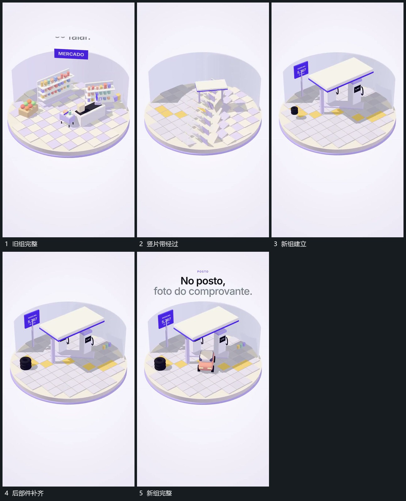

# 侧方竖片带逐段翻过，覆盖旧组后新组同区接管

## 运动指令

保留圆底位置，让竖向片带从侧方逐段翻过。片带覆盖经过时旧组退出，新组在同一底区依次接入，最后片带离开，部件完整保持。

## 视频切片

[播放本机制的原片切片](m03.mp4)

覆盖分镜中“旧组完整”至“新组完整”的连续过程，并保留邻近的前后衔接画面；原片中交叠发生的动作一并保留。

## 分镜过程

## 组合与调整

新旧组共享底区，翻转带不必继承原片几何结构，但应覆盖真实交界。
