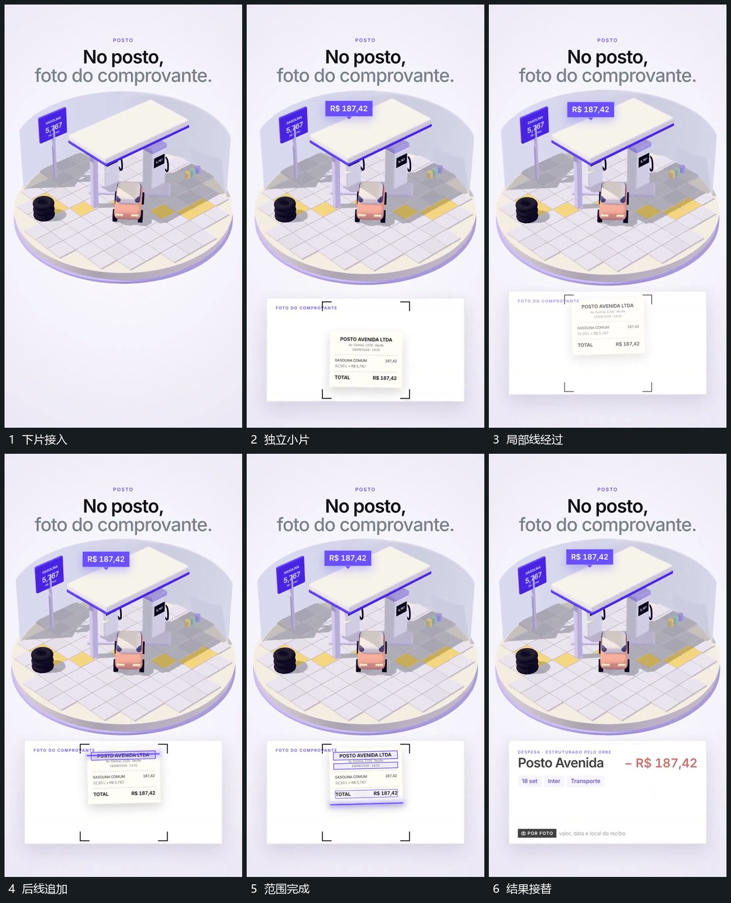

# 角框限定独立小片，局部横线顺序经过后换结果片

## 运动指令

在下方片面中接入独立小片，先用角框限定其范围，再让局部横线顺序经过不同位置。小片来源保持，过程完成后结果片接替原承载位置。

## 视频切片

[播放本机制的原片切片](m04.mp4)

覆盖分镜中“下片接入”至“结果接替”的连续过程，并保留邻近的前后衔接画面；原片中交叠发生的动作一并保留。

## 分镜过程

## 组合与调整

结果反馈不代表现实识别能力，采用可见过程即可。
