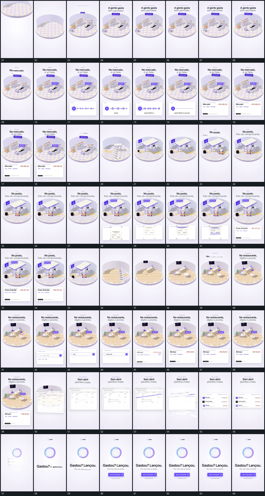

# 058｜原片运动总览

[观看完整原片](video.mp4)

## 运动总览

开头 圆形底区接入，局部部件逐项建立，小形在内经过 接入圆形底区，再逐项建立后层与局部部件，小形在底区内经过。固定片内短柱伸缩，文字逐字增加后结果片接替 下方固定片里短柱持续伸缩，文字逐字增加，完成后换成结果片。侧方竖片带逐段翻过，覆盖旧组后新组同区接管 让竖向片带从侧方翻过，旧组随覆盖退去，新组在同一底区接管。

中段 角框限定独立小片，局部横线顺序经过后换结果片 在下方片内接入独立小片，角框限定范围，局部横线按顺序经过，再换成结果片。又用 侧方竖片带逐段翻过，覆盖旧组后新组同区接管 接入下一组，长条逐字输入，完成后同位置短反馈片接替 让固定长条逐字输入，输入完成后短反馈片接替。后段大平面入场，斜向长带经过大平面，内部布局接替后中央环形接管 斜向长带经过并替换内部布局，旧平面退虚，中央圆环接管，主字与附属条分项补齐收尾。

## 完整运动段落

以下按原片中的出现顺序引用。建立、内部发展及完成反馈放在同一段中；同时发生的局部动作与运镜写在同一份指令里。不同段之间可以是连续接管，也可以是直接切换，不能仅凭条目相邻认定可直接拼接。重复出现的同类运动采用一次连续代表范围，切片不以逐段无缝覆盖整片为目标。

1. [圆形底区建立并补入部件，下方面板接力呈现结果](mechanisms/m07.md)：圆形底区先落位，内部部件逐项建立，小形持续经过；下方固定片接入，短柱、输入和结果片依次完成。

2. [竖片翻过换入新组，下方扫描与结果片承接](mechanisms/m08.md)：侧方片带逐段翻过遮住旧组，新组在同一区域落位；下方独立片被角框限定，横线扫描后接入结果片。

3. [长条逐字输入，完成后同位置短反馈片接替](mechanisms/m05.md)：输入先结束，反馈随后换入

4. [斜向长带经过大平面，内部布局接替后中央环形接管](mechanisms/m06.md)：斜带先覆盖，再退面留中心

切片保留起始准备、必要内部停顿和完成或明确交接；首尾省略无新发展的等待，持续运动不要求人为停住。以上基于真实源帧序列和重点边界核对，不等同于全片连续声画审片。

## 完整64宫格

