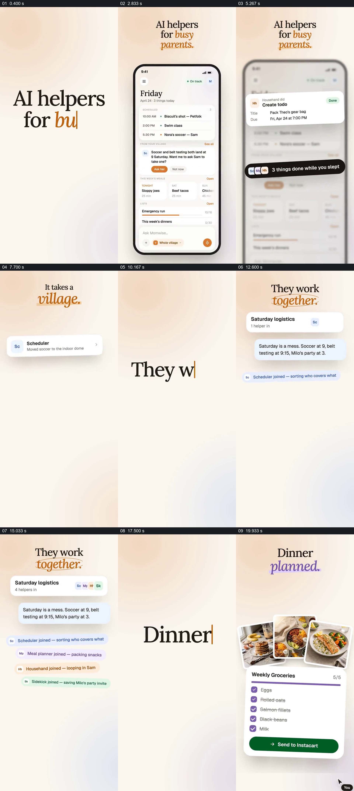

# 用多位助手的接力处理家庭安排并落到购物清单

- 作品：案例 030《家庭事务助手的协作与结果》（索引名称）。
- 原片范围：00:00.000–00:22.000，含起点、不含终点；[完整原片](../video.mp4)｜[本卡片段](c01.mp4)。
- 观察方式：依据整片 64 宫格和约每秒一次的真实源帧观察，未连续原速观看或听审；声音、语气与完整播放节奏未确认。

## 原画面具体怎样设计

竖屏浅色背景先写“AI helpers for busy parents.”，手机展示一天的事项和任务提示。随后“ It takes a village.”下列出日程、餐食和家庭等助手；一条周末安排消息下逐行出现不同颜色的处理记录，再显示日历卡。接着“Dinner planned.”下面出现餐食照片与每周购物清单，底部有发送按钮。

## 为什么这样设计，好在哪里

先用已有日程说明任务场景，再把不同职责排在同一条请求下，最后给出日历和购物清单两个可见结果；观众能追踪协作对象及其去向。画面不证明助手实际执行或采购已完成。

以上为依据画面的分析，非作者自述；预期观看效果未经观众测试。

## 可直接使用的创意指令

当多个角色共同处理一项复杂事务时，准备一条真实且经过授权的请求，明确各角色负责的部分；在共同上下文中依次展示处理状态，并将已确认的结果落到日历、清单等实际交付位置。自动化和外部操作以真实状态为准，私人信息按授权展示。
