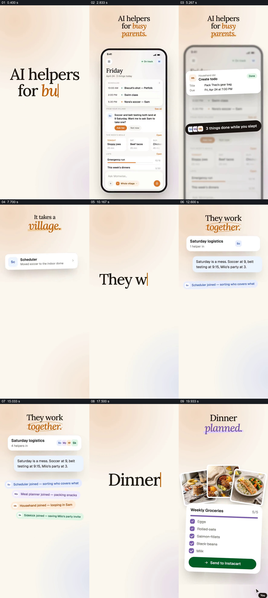

# 让不同助手围绕同一家庭请求接力，再把安排落到清单

- 作品：案例 030《手机中的餐饮与协作》（库内索引名称）。
- 原片范围：00:00.000–00:22.000，含起点、不含终点；[完整原片](../video.mp4)｜[本卡片段](c01.mp4)。
- 范围依据：从家庭日程与助手活动建立，经角色与周六协调，到晚餐和购物清单完成状态；之后进入文字总结。
- 观察方式与未确认范围：查看整片 64 帧总览和本卡分镜。未独立完成连续原速观看与听审；抽帧之间的运动、停顿与声音配合待复核。画面中的界面、数字与说明是作品呈现，未经额外核实；设计价值为基于画面的分析。

## 原画面具体怎样设计

竖屏暖白背景上，“AI helpers for busy parents”先作为大标题，随后一部手机显示周五日程、家庭消息、餐食和列表。手机被虚化时，前景单独突出已完成的待办卡及“睡觉时完成了三件事”的状态条，让日程从密集界面变成可读的一件事。

手机退出后，标题变为“It takes a village”，不同颜色的小卡依次列出日程、餐食、家庭事务等助手身份。接着出现一条周六安排消息：足球、考试和聚会时间挤在一起；下方蓝、紫、橙、绿状态条分别显示不同助手加入，顶部参与者标识也从一个增加到多个，最后另有一张时间安排卡。

画面再转到“Dinner planned”，三张餐食照片叠放在购物清单上缘，清单列出食材、勾选状态和发送按钮。前面的协作说明最终接到能够辨认的安排和餐食产物，但片中没有证明这些任务真实完成。

## 为什么这样设计，好在哪里

先从手机里的真实感日程指出家庭事务交织，再把多人角色单独列出，最后让他们围绕同一条具体请求依次出现；观众不仅看到有几个助手，也能理解各自负责哪部分。晚餐照片与食材清单把抽象的“规划”落在可查看的结果上，色彩和参与标识帮助追踪角色。

周六协调与晚餐清单是相关的家庭事务示例，不能仅凭抽帧断定它们属于同一次真实执行。

## 完整照排指令

以[完整原片](../video.mp4)的 0–22 秒为准。画幅 590×1280，源帧率 30/1。以下拍点为抽帧定位，位置按画幅百分比取近似值。

### 用料

【家庭日程】【任务弹卡】【助手卡组】【周末请求】【接手状态组】【整理后日程】【菜品照片组】【购物清单】来自同一家庭示例，遮去可识别私人信息。各助手状态必须回指请求中的具体事项；菜品与清单逐项核对。备【开场标题】【角色标题】【协作标题】【晚餐标题】【计数标签】【发送按钮】【邻段品牌】【邻段标题】。若展示真实传送或完成，附可核对的操作记录和状态。

### 按源时刻摆放

1. **0–约 6 秒。** 竖幅奶白，左上暖杏光、右下略冷。居中深色大衬线逐字写【开场标题】，强调部分赭橙斜体。整组上移，细黑手机从底部进入，中轴显示白底【家庭日程】。随后手机放大并稍虚，白色【任务弹卡】靠中上浮到清晰前层，右侧小绿完成标记。斜贴黑胶囊【计数标签】在下方出现，背景日程仍可认。
2. **约 6–10 秒。** 手机整组退出，奶白底中轴换【角色标题】，同样用黑正体加赭橙斜体，随后标题上移。下方四条白圆角【助手卡组】错时加入，字左齐，小色标与角色对应。保留已到位的行，较独立的补充通知晚一点在下部倾斜进入；随后整组退场。
3. **约 10–17.500 秒。** 【协作标题】由居中打字变为顶部。中上先出白色任务摘要，下方淡蓝对话块显示【周末请求】。摘要右端小色标随各助手接手而增加。中下由蓝到紫、橙、绿逐条加【接手状态组】，旧行保留。近末拍底部白卡【整理后日程】从下进入，与消息及状态同屏。界面可由真实截图分层，禁止动画循环重置计数或把状态行改成无关模板。
4. **约 17.500–21 秒。** 日程组退，奶白底上换【晚餐标题】，强调词转紫色斜体。三张【菜品照片组】错角成叠，从中部扩开；照片仍在时，前景白【购物清单】由下叠入，紫色勾按行填，顶部进度与已勾项对应。底部深绿长圆角【发送按钮】从默认到确认，必须有对应操作依据。照片可定格，直到清单整版退出。
5. **约 21–22 秒。** 清单与照片退，暖底上中先出细黑【邻段品牌】，其下逐字建立【邻段标题】，按 22.000 秒切出。

### 局部采用

只具备同一协调请求与状态记录，可用约 10–17.500 秒。只有配对菜品和清单，可用约 17.500–21 秒，缺发送记录时在发送前结束。

### 验证状态

已对照每秒两帧原片画序并读回。核对任务清晰而手机在后、协作行逐条保留、清单压在菜图前和按钮后续状态。精确切帧、原速听看和换料试摆待核。
