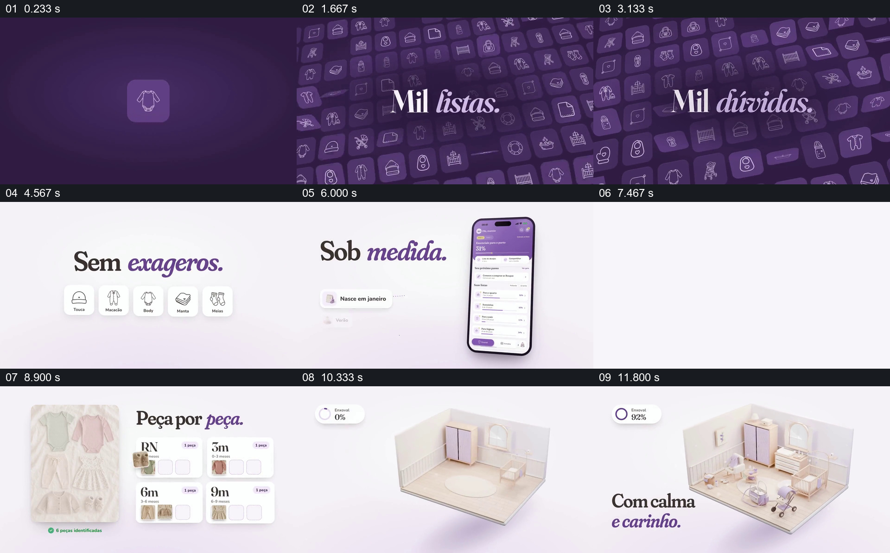

# 从用品过多的疑问，走到分龄清单和逐步备齐的房间

- 作品：案例 033《母婴用品照片分类与房间组装》（库内索引名称）。
- 原片范围：00:00.000–00:13.000，含起点、不含终点；[完整原片](../video.mp4)｜[本卡片段](c01.mp4)。
- 范围依据：从密集用品和疑问开始，覆盖条件、分龄归类以及房间与进度的完成画面；13 秒后进入品牌收尾。
- 观察方式与未确认范围：查看整片 64 帧总览和本卡分镜。未独立完成连续原速观看与听审；抽帧之间的运动、停顿与声音配合待复核。画面中的界面、数字与说明是作品呈现，未经额外核实；设计价值为基于画面的分析。

## 原画面具体怎样设计

深紫色背景里，一个婴儿衣物图标扩展为充满画面的用品小图标，中央文字先后显示“许多清单”“许多疑问”。背景转浅，密集图标收束为帽子、连体衣、毯子和袜子等几张可辨认的白色小卡，上方写“不过度”。

手机出现在右侧，左边出现出生月份、季节等条件标签，手机列表中则显示用品类别和进度。随后一张衣物平铺照片在左侧，右侧是新生儿、3 个月、6 个月和 9 个月的格子，部分衣物以缩略图的形式对应到不同年龄组。

接下来是浅色等距房间：起初只有少量家具与地毯，后续抽帧中床、收纳和婴儿用品更加完整；左上角环形进度从 0% 变化到 92%、100%，旁边出现“从容和关爱”的文字。房间的逐步充实与数字并列，但每个家具是否精确对应清单项目无法从抽帧核实。

## 为什么这样设计，好在哪里

先让满屏图标代表选择负担，再缩为少量基础对象，画面本身完成从繁杂到可处理的转变。条件标签解释清单为何因人而异；真实感衣物图与分龄格并列，让分类有具体对象。最后将百分比放在逐渐充实的房间旁，使抽象进度对应可理解的准备结果。

片中的分类、进度和识别数量是演示，不能据此确认母婴用品建议、识别准确率或真实购买状态。

## 可直接使用的创意指令

针对需要准备多件物品的任务，先展示真实选择范围及导致犹豫的因素，再依据明确条件收束成有限清单。使用实际物品照片或清楚标注的示意，把每件放入有依据的类别；最后用可核对的空间、成品或集合呈现完成情况，并明确进度的计算口径。

题材可换成搬家、旅行或设备配置；图标数量、色彩和房间形式可改变，但条件、分类和实际完成状态之间的对应不能省略。

本方法尚未在新题材中实测。
