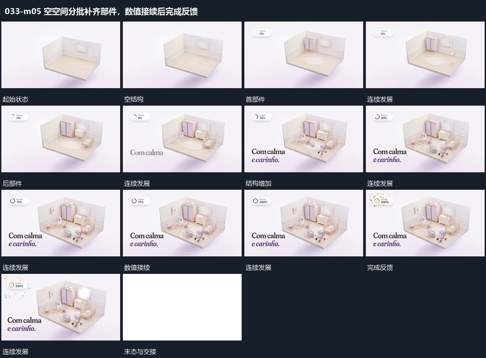

# 空空间分批补齐部件，数值接续后完成反馈

## 运动指令

在空空间中按位置分批补入部件，先建立的保持，后部件补进剩余空位。结构逐步完整时旁侧数值继续增加，末尾才出现完成小圈及短促散片；随后用亮闪遮蔽整组退出。

## 视频切片

[播放本机制的原片切片](m05.mp4)

覆盖分镜中“空结构”至“亮闪退出”的连续过程，并保留邻近的前后衔接画面；原片中交叠发生的动作一并保留。

## 分镜过程

## 组合与调整

数量可改变，完成反馈应等到主要结构完整，不以闪光掩盖未建立的部分。
