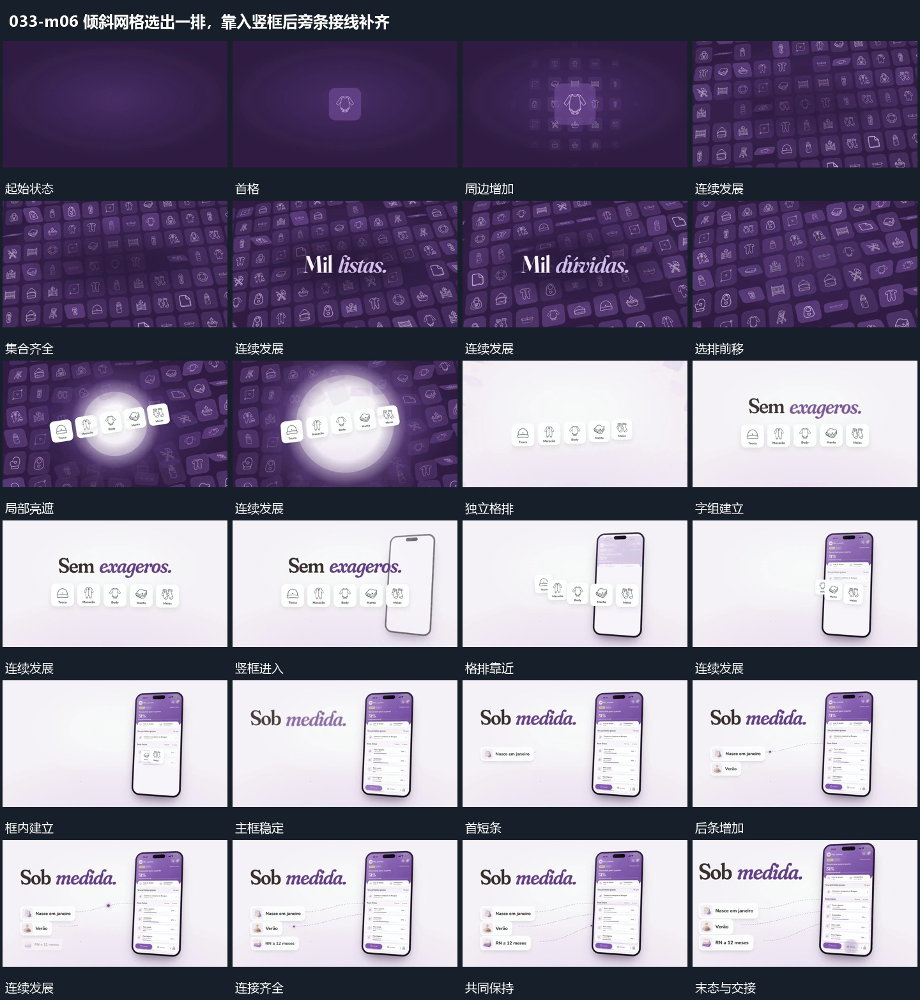

# 倾斜网格选出一排，靠入竖框后旁条接线补齐

## 运动指令

倾斜集合先形成，一排小格向前突出并带出新底；这排向竖框靠拢后由框接手，旁条逐项补入并连回内部。

1. **小格铺成倾斜集合，选出一排前移后换底**

从首个小格开始补入周边小格，逐渐形成倾斜的满幅集合。选出其中一排前移，外围小格退淡；局部亮遮经过后换入新底层，只保留选中的一排作为后续运动对象。

2. **一排小格向竖框靠拢，由新框接手内部内容**

保留独立小格排，先在旁侧接入竖框。让小格排向竖框靠近并退去，竖框内部同步建立新内容，使原集合的动作自然交给单个承载区。

3. **侧方短条逐项增加，虚线连接到固定框内局部**

让固定主框保持，在侧边逐项接入短条。每条出现后以虚线连接到框内对应局部，后条接入时前条和连接保留；全部齐全后留出整体保持。

整段结束：侧条与局部连接齐全 保留必要落稳与交接，中间已建立的参照沿用到下一步骤。

## 视频切片

[播放本机制的原片切片](m06.mp4)

保留起始准备、连续发展和完成或明确交接；首尾按本段运动范围裁切，不拼接、不变速。相连的小动作合为同一完整段落。

## 分镜过程

## 组合与调整

倾斜集合先形成，一排小格向前突出并带出新底；这排向竖框靠拢后由框接手，旁条逐项补入并连回内部。 复用时可调整元素数量、幅度和相对节奏，保留上述进入、交叠与完成关系；不直接沿用原片题材或时长。

可换格内内容，保持选排来自原集合。换底期间选排需要保持可追踪。

不要把小格直接切没。对齐小格靠近的方向与新框位置。

可以改变条数和端点，连接需有明确对应位置，不能把线当作随意装饰运动。
