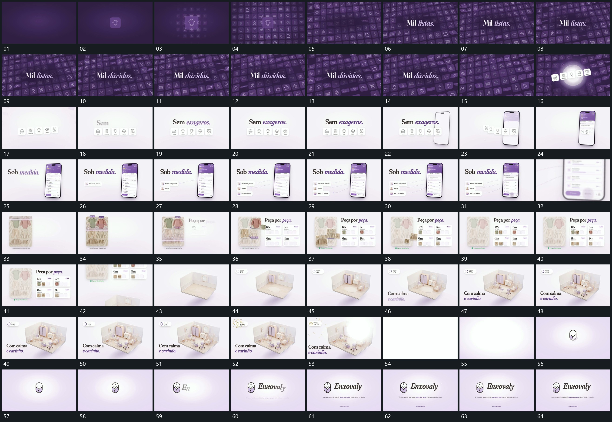

# 033｜原片运动总览

[观看完整原片](video.mp4)

## 运动总览

开场 小格铺成倾斜集合，选出一排前移后换底 将小格从少到多铺成倾斜集合，随后选出一排前移，外围退淡并换底。一排小格向竖框靠拢，由新框接手内部内容 让这排小格向新竖框靠拢，竖框接手内部内容。

竖框落稳后 侧方短条逐项增加，虚线连接到固定框内局部 从侧方逐项追加短条，以虚线连向框内局部。整组推近退场，下一竖片用 原图局部标框，副本逐项提入旁侧空槽 标出多个局部，再将局部副本填入旁侧面板。最后换入空空间，空空间分批补齐部件，数值接续后完成反馈 分批补齐各部件，完成反馈出现后用亮闪退出，字组建立并保持。

## 完整运动段落

以下按原片中的出现顺序引用。建立、内部发展及完成反馈放在同一段中；同时发生的局部动作与运镜写在同一份指令里。不同段之间可以是连续接管，也可以是直接切换，不能仅凭条目相邻认定可直接拼接。重复出现的同类运动采用一次连续代表范围，切片不以逐段无缝覆盖整片为目标。

1. [倾斜网格选出一排，靠入竖框后旁条接线补齐](mechanisms/m06.md)：倾斜集合先形成，一排小格向前突出并带出新底；这排向竖框靠拢后由框接手，旁条逐项补入并连回内部。

2. [原图局部标框，副本逐项提入旁侧空槽](mechanisms/m04.md)：标出来源，再提副本填槽

3. [空空间分批补齐部件，数值接续后完成反馈](mechanisms/m05.md)：部件分批增加，反馈最后出现

切片保留起始准备、必要内部停顿和完成或明确交接；首尾省略无新发展的等待，持续运动不要求人为停住。以上基于真实源帧序列和重点边界核对，不等同于全片连续声画审片。

## 完整64宫格

