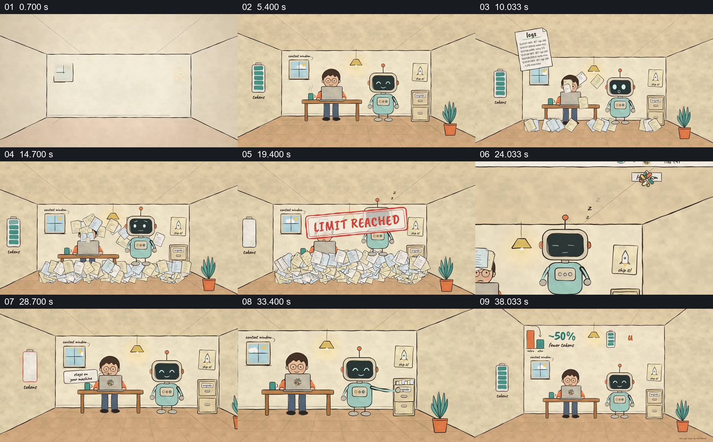

# 在同一工作空间里先堆积负担，再展示清理后的变化

- 作品：案例 078《上下文负担与整理工具》（本次概括）。
- 原片范围：00:00.000–00:42.000，含起点、不含终点；[完整原片](../video.mp4)｜[本卡片段](c01.mp4)。
- 观察方式：依据约每秒一次的真实源帧观察，未连续原速观看或听审；声音、语气与完整播放节奏未确认。

## 原画面具体怎样设计

办公室从空房间建立，人物在电脑前工作，机器人站在旁边，墙上容量条起初充满。标有日志、JSON、工具输出等的纸页不断落下并堆满地面，容量条降至空，画面盖上 LIMIT REACHED。机器人再次出现后，纸张逐渐清走，人物和机器人回到同一位置，机器人拿起一张纸；最后画面中出现减少约 50% 和最多两倍等宣传数字，容量条重新充满。

## 为什么这样设计，好在哪里

把信息负担变成逐渐淹没同一房间的纸张，既保留材料来源，又使容量耗尽可见；同一空间被清理后更容易对照变化。数字和效率效果是作品宣称，未独立验证。

以上为依据画面的分析，非作者自述；预期观看效果未经观众测试。

## 可直接使用的创意指令

解释资料或上下文整理时，在同一工作位置建立用户、助手和可辨的容量参照，让真实存在的多类材料逐步累积到影响工作的状态；再展示实际整理如何处理这些材料及保留下来的关键内容，并用可核查的前后指标收束。视觉上的纸张和容量条只是示意，具体效率数字需有测试依据。
