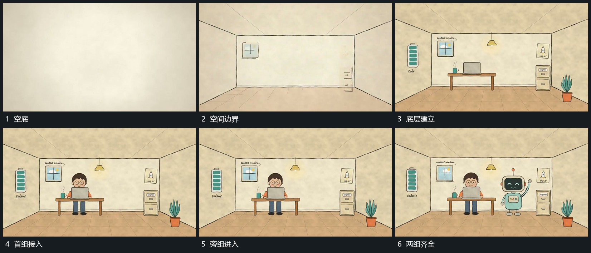

# 空空间先描边再依次放入底层与双组

## 运动指令

先从空底延长斜线与横线，形成共同空间边界。底部承载层和侧边小区随后分次出现，首组在底层后接入，第二组再从旁侧进入。已有结构保持，新增部分依次占据空处。

## 视频切片

[播放本机制的原片切片](m01.mp4)

覆盖分镜中“空底”至“两组齐全”的连续过程，并保留邻近的前后衔接画面；原片中交叠发生的动作一并保留。

## 分镜过程

## 组合与调整

空间可以更简洁；保留边界、底层和主组的建立顺序，避免所有部分同时闪现。
