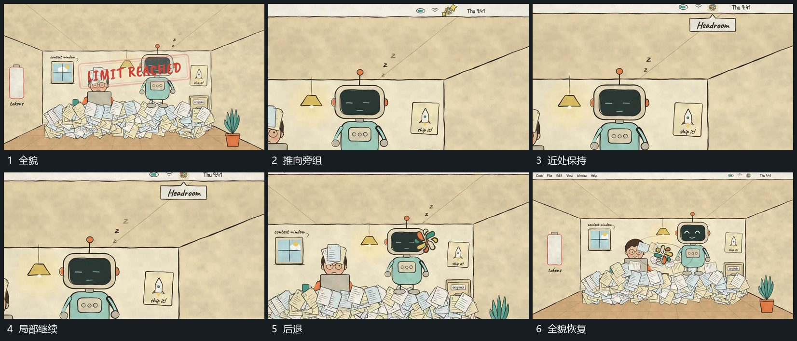

# 推向旁组局部后退回同一空间

## 运动指令

沿旁组位置持续推近，使外围边界和堆积片层越出画面，旁组上部成为主要范围。其局部小形仍活动，近处短条可以接入。随后沿同一空间退镜，重新露出双组、边界和底部片层。

## 视频切片

[播放本机制的原片切片](m03.mp4)

覆盖分镜中“全貌”至“全貌恢复”的连续过程，并保留邻近的前后衔接画面；原片中交叠发生的动作一并保留。

## 分镜过程

## 组合与调整

使用局部视野时仍保留一两处原边界；退回后不重新摆放已有堆积。
