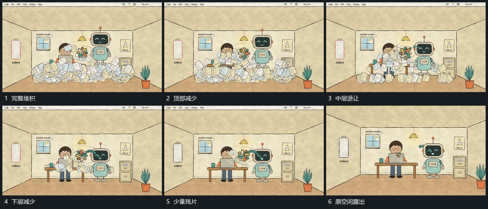

# 多层堆积由上到下退去露出原空间

## 运动指令

先让堆积上部的片层减少，剩余片向下移动并逐批退出；中层、下层依次退让，原底层和双组随着遮挡消退重新露出。旁侧小形继续局部转动，最后残片退净，恢复原空间的空处。

## 视频切片

[播放本机制的原片切片](m04.mp4)

覆盖分镜中“完整堆积”至“原空间露出”的连续过程，并保留邻近的前后衔接画面；原片中交叠发生的动作一并保留。

## 分镜过程

## 组合与调整

只描述可见回收，不推定清空算法；每批退去后原结构应从同一位置露出。
