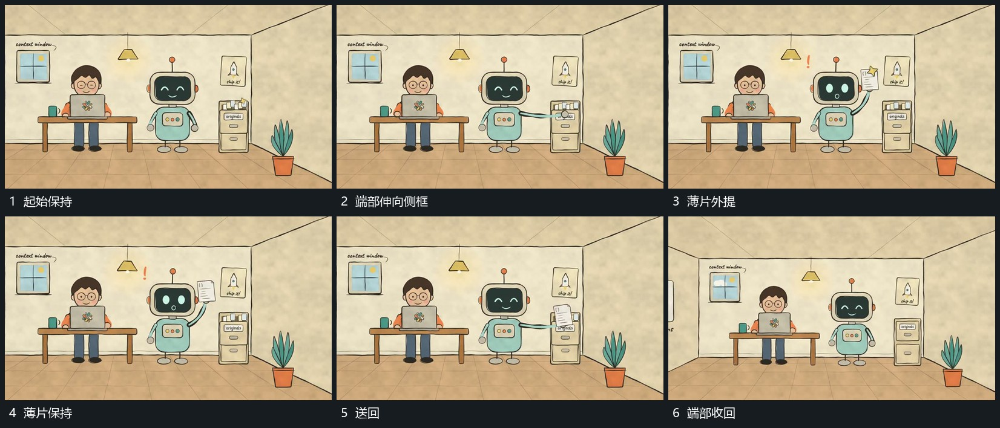

# 侧边端部伸出外提薄片再送回

## 运动指令

从旁组侧边伸出细长端部，对准相邻小框并把一张薄片向外提起。薄片在旁组上方短暂保持，小强调线可从其边缘短促展开；随后沿原方向送回侧框，端部缩回，其他层保持。

## 视频切片

[播放本机制的原片切片](m05.mp4)

覆盖分镜中“起始保持”至“端部收回”的连续过程，并保留邻近的前后衔接画面；原片中交叠发生的动作一并保留。

## 分镜过程

## 组合与调整

可把侧框换成任意存放区；外提与送回沿同一来源位置，不在空中更换薄片身份。
