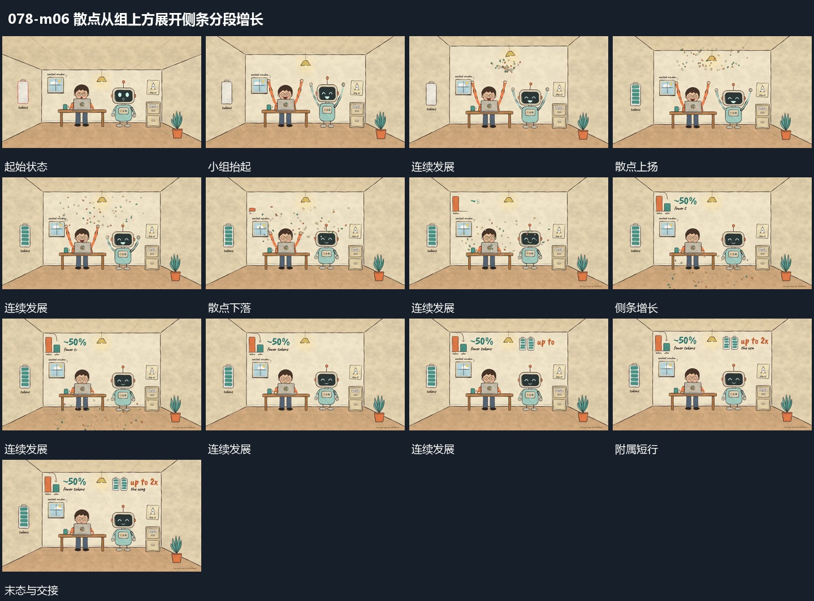

# 散点从组上方展开侧条分段增长

## 运动指令

让组形局部先抬起，散点从其上方向外展开，再分散下降并退去。与此同时侧边长条由少到多分段补入，顶部短行依次接入；双组回到原位，外围变化完成后共同保持。

## 视频切片

[播放本机制的原片切片](m06.mp4)

保留起始准备、连续发展和完成或明确交接；首尾按本段运动范围裁切，不拼接、不变速。尾部只保留理解结果所需的展示。

## 分镜过程

## 组合与调整

散点和长条可以分别采用，但其作用范围保持分离；不要让长条增长挤动主组。
