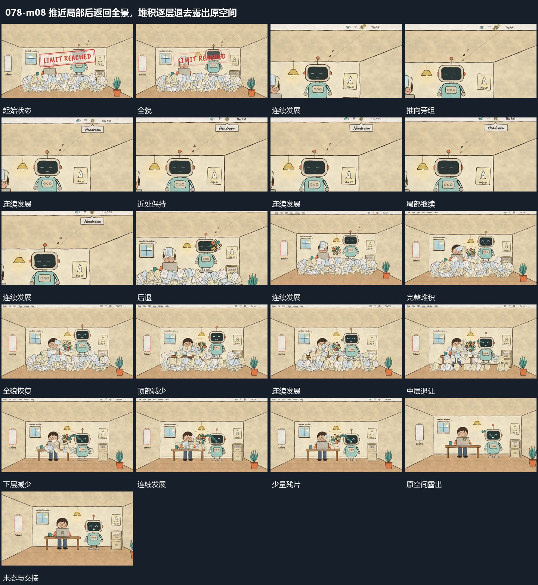

# 推近局部后返回全景，堆积逐层退去露出原空间

## 运动指令

先向局部推进再退回同一空间，在回到全景后让堆积从上到下依次退出，原空间逐步显露。

1. **推向旁组局部后退回同一空间**

沿旁组位置持续推近，使外围边界和堆积片层越出画面，旁组上部成为主要范围。其局部小形仍活动，近处短条可以接入。随后沿同一空间退镜，重新露出双组、边界和底部片层。

2. **多层堆积由上到下退去露出原空间**

先让堆积上部的片层减少，剩余片向下移动并逐批退出；中层、下层依次退让，原底层和双组随着遮挡消退重新露出。旁侧小形继续局部转动，最后残片退净，恢复原空间的空处。

整段结束：片层退净且原双组重新露出 保留必要落稳与交接，中间已建立的参照沿用到下一步骤。

## 视频切片

[播放本机制的原片切片](m08.mp4)

保留起始准备、连续发展和完成或明确交接；首尾按本段运动范围裁切，不拼接、不变速。相连的小动作合为同一完整段落。

## 分镜过程

## 组合与调整

先向局部推进再退回同一空间，在回到全景后让堆积从上到下依次退出，原空间逐步显露。 复用时可调整元素数量、幅度和相对节奏，保留上述进入、交叠与完成关系；不直接沿用原片题材或时长。

使用局部视野时仍保留一两处原边界；退回后不重新摆放已有堆积。

只描述可见回收，不推定清空算法；每批退去后原结构应从同一位置露出。
