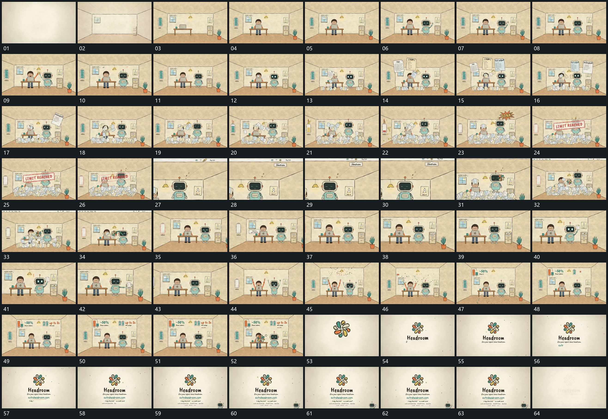

# 078｜原片运动总览

[观看完整原片](video.mp4)

## 运动总览

全片以空空间先描边再依次放入底层与双组从空线框建立完整空间和两组形，继而薄片错位经过后落到底部不断累积让多张薄片在上方错位经过、落到下部并不断累积。侧条随累积逐段减少，前层短标接入；推向旁组局部后退回同一空间把视野推向旁组局部，再退回全貌。

新小形接入后用多层堆积由上到下退去露出原空间逐层清空堆积，空间重新露出。侧边端部伸出外提薄片再送回将旁侧薄片沿伸出的端部外提、保持、再送回；之后散点从组上方展开侧条分段增长向上展开散点并让侧条重新增长。结尾以局部小形放大接管空底再补结尾字行由局部小形放大接管空底，再逐行建立收尾文字。

## 完整运动段落

以下按原片中的出现顺序引用。建立、内部发展及完成反馈放在同一段中；同时发生的局部动作与运镜写在同一份指令里。不同段之间可以是连续接管，也可以是直接切换，不能仅凭条目相邻认定可直接拼接。重复出现的同类运动采用一次连续代表范围，切片不以逐段无缝覆盖整片为目标。

1. [空空间先描边再依次放入底层与双组](mechanisms/m01.md)：边界先成形内部后进入

2. [薄片错位经过后落到底部不断累积](mechanisms/m02.md)：上方经过下方累积

3. [推近局部后返回全景，堆积逐层退去露出原空间](mechanisms/m08.md)：先向局部推进再退回同一空间，在回到全景后让堆积从上到下依次退出，原空间逐步显露。

4. [侧边端部伸出外提薄片再送回](mechanisms/m05.md)：伸出取出保持归位

5. [散点从组上方展开侧条分段增长](mechanisms/m06.md)：上方散开侧边累积

6. [局部小形放大接管空底再补结尾字行](mechanisms/m07.md)：放大接管后缩定补字

切片保留起始准备、必要内部停顿和完成或明确交接；首尾省略无新发展的等待，持续运动不要求人为停住。以上基于真实源帧序列和重点边界核对，不等同于全片连续声画审片。

## 完整64宫格

