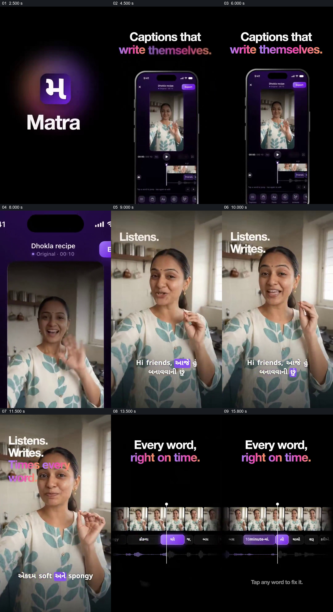

# 从手机里的示例进入人物，再展示字幕与时间线

- 作品：案例 006《手机中的人物与数字人展示》（索引名称）。
- 原片范围：00:00.000–00:16.700，含起点、不含终点；[完整原片](../video.mp4)｜[本卡完整片段](c01.mp4)。
- 观察方式：按整片 64 宫格和约每秒一个原片帧观察全片，并选取下方九个源帧；未连续原速观看或听审，语言内容、字幕准确性及声音同步保持未知。

## 原画面具体怎样设计

黑底上先出现 Matra 标识，随后一部手机显示人物短视频和字幕编辑界面，标题写“Captions that write themselves”。画面推近手机中的人物，使她占满竖屏；左上依次出现 Listens、Writes 和 Times every word，人物画面下方显示英语与古吉拉特语混合字幕，部分词以紫色突出。随后人物缩略图序列、词语块和波形并列，竖线落在当前词上，文字提示可点词修正。

## 为什么这样设计，好在哪里

先从手机整体进入被编辑的内容，观众知道字幕作用于哪段视频；再把人物、具体字幕和时间线对应起来，片中的功能主张因此有可见对象。静帧无法证明识别准确、逐词时间或声音同步，混合语言内容也未经听审翻译。 这是基于画面的作品分析，不代表作者自述或已测量的观众反应。

## 可直接使用的创意指令

当要解释真实视频的字幕处理流程时，先让观众看到待处理的主体及其原始环境，再用同一片段展示字幕结果；切换到编辑视图时保持画面、词语块和时间参照的对应，并展示实际可用的修正方式。字幕文字和时序应以真实语言及对齐证据核对；示意界面不能代替对识别质量、口型或声音同步的验证。
