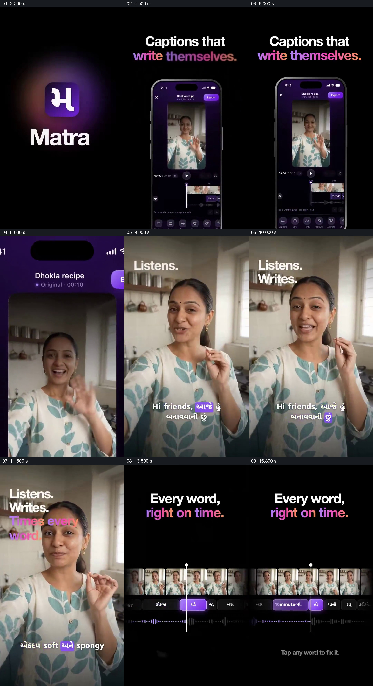

# 从手机界面走进人物，再把字幕拆回时间线

- 作品：案例 006，手机字幕编辑工具展示（库内案例）。
- 原片范围：0.000–16.700 秒；[完整原片](../video.mp4)｜[本卡片段](c01.mp4)。范围含起点、不含终点；末尾以原文件流长度为准。
- 观察方式与未确认范围：查看整片 64 帧总览和本卡九宫格；未独立完成原速连续观看或听审，采样间的运动、停顿、声音和同步未确认。以下创意价值是依据画面作出的分析，新题材迁移尚未实测。

## 原画面具体怎样设计

竖屏黑底上先出现 Matra 图标与名称，随后上方标题写“Captions that write themselves.”，其下方是一部竖直手机。手机屏幕内是厨房里的女性视频，底部仍能看见预览控制、时间线缩略图、词块和声音波形。约 8 秒，观察范围靠近手机预览，手机边界逐渐退出，人物画面接管整个竖屏。

人物画面的左上依次出现“Listens.”、“Writes.”和“Times every word.”，下方是英文和古吉拉特文字混排的字幕，个别词位有紫色底色。随后人物让位于黑底编辑示意：上方写“Every word, right on time”，中央是同一人物的小缩略图条，下面的词块、声音波形及竖直指示线组成时间线；不同源帧中紫色高亮落在不同词块，底部提示可以点击词语修改。

## 为什么这样设计，好在哪里

手机外框先建立“这是一个编辑工具”的位置关系，进入预览后人物从小窗口变成观看主体，让观众可以直接看到字幕与人的关系。再切回时间线时，同一人物的小缩略图保留了来源参照，字幕词块与波形并列，使观众看见作品中的文字与编辑对象可能如何关联。

这是一种由完成效果回到工作界面的展示次序；如果直接展示波形和按钮，观众会少一个关于成品的直观参照。画面只能证明产品声称逐词计时，截图本身无法验证字幕识别准确或和实际语音精确同步。

## 可直接使用的创意指令

适用于展示一项编辑能力既要让观众看到成品，又要让其理解可调整的位置。先以熟悉的设备或编辑窗口建立作品所在处；从同一个预览进入足够大的内容画面，使观众看清人物、字幕或效果的对应。再让该内容的可识别片段以缩略图、素材条或其他参照形式出现在编辑区，旁边展示可以操作的词块与必要的时间信息。

设备、语言、颜色、画幅和工具样式可变；需保留“成品表现—同一素材的编辑表示—明确可操作对象”的关系。语言文字必须可核对，计时精度与声音同步应另行复核。
