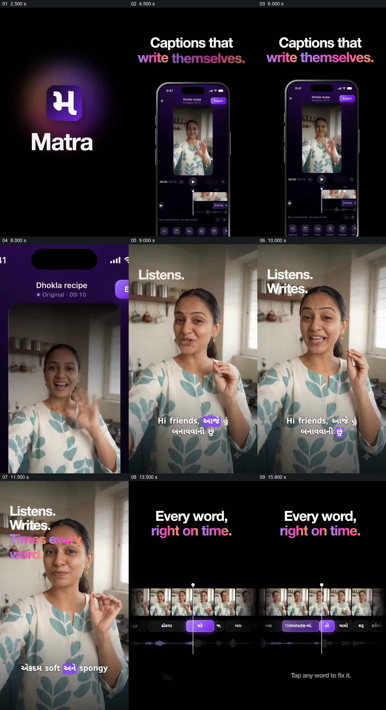

# 从手机界面走进人物，再把字幕拆回时间线

- 作品：案例 006，手机字幕编辑工具展示（库内案例）。
- 原片范围：0.000–16.700 秒；[完整原片](../video.mp4)｜[本卡片段](c01.mp4)。范围含起点、不含终点；末尾以原文件流长度为准。
- 观察方式与未确认范围：查看整片 64 帧总览和本卡九宫格；未独立完成原速连续观看或听审，采样间的运动、停顿、声音和同步未确认。以下创意价值是依据画面作出的分析，新题材迁移尚未实测。

## 原画面具体怎样设计

竖屏黑底上先出现 Matra 图标与名称，随后上方标题写“Captions that write themselves.”，其下方是一部竖直手机。手机屏幕内是厨房里的女性视频，底部仍能看见预览控制、时间线缩略图、词块和声音波形。约 8 秒，观察范围靠近手机预览，手机边界逐渐退出，人物画面接管整个竖屏。

人物画面的左上依次出现“Listens.”、“Writes.”和“Times every word.”，下方是英文和古吉拉特文字混排的字幕，个别词位有紫色底色。随后人物让位于黑底编辑示意：上方写“Every word, right on time”，中央是同一人物的小缩略图条，下面的词块、声音波形及竖直指示线组成时间线；不同源帧中紫色高亮落在不同词块，底部提示可以点击词语修改。

## 为什么这样设计，好在哪里

手机外框先建立“这是一个编辑工具”的位置关系，进入预览后人物从小窗口变成观看主体，让观众可以直接看到字幕与人的关系。再切回时间线时，同一人物的小缩略图保留了来源参照，字幕词块与波形并列，使观众看见作品中的文字与编辑对象可能如何关联。

这是一种由完成效果回到工作界面的展示次序；如果直接展示波形和按钮，观众会少一个关于成品的直观参照。画面只能证明产品声称逐词计时，截图本身无法验证字幕识别准确或和实际语音精确同步。

## 完整照排指令

以[完整原片](../video.mp4)的 0–16.7 秒为准。画幅 720×1280，源帧率 30/1。以下拍点为抽帧定位，位置按画幅百分比取近似值。

### 用料

- 【人物原片】取同一段竖屏连续口播，保持手势、口型和衣着。手机预览、放大后的全屏和时间线缩略帧均由该片生成，一次裁切三处共用。准备【逐词字幕】【逐词时间点】和同段的【语音波形】；混语或方言按实际发音复核。功能演示如需证明实际能力，附可打开的说明或同一案例的编辑录屏。
- 【开场提示】【产品标志】【产品名】【功能首句】【功能次句】【工作短语组】【时间线标题】【编辑提示】【邻段样式标题】各准备短文。另备【手机编辑画面】的黑紫编辑壳、片名位置和时间线。

### 按源时刻摆放

1. **0.000–约 3.500 秒。** 竖幅铺黑。中央先浮灰白小【开场提示】再淡去。紫色圆角【产品标志】从轻虚走到清，周围有紫橙晕光，下面用白粗【产品名】。整体让位给手机，不留重叠标志。
2. **约 3.500–8.000 秒。** 手机从底部上行，落在中轴，宽约画宽六成，底边最初截在画外。框内用【手机编辑画面】包住【人物原片】，其上是黑紫标题和亮紫按钮，下为播放条、缩略帧及工具小图标。手机上方居中两行，白粗【功能首句】、紫粉橙渐变【功能次句】。近 7.5 秒手机拉近，优先放大屏内人，逐步让壳和标题超出画边。
3. **约 8.000–12.000 秒。** 【人物原片】接管全幅，保留由手机中可认出的同一姿态和时钟。左上一路叠白粗【工作短语组】，强调行用渐变，组内各句左齐。在腹胸交界处两行小白【逐词字幕】，当前读词出现宽度随字形的紫底高亮。高亮按实测【逐词时间点】移到下一词，不与镜头推移绑定。禁用重播起始动作或照片运镜。约 12 秒人物淡黑。
4. **约 12.000–16.000 秒。** 黑底上方改居中两行大【时间线标题】，第一行白，第二行渐变。画中略偏下由上到下并排缩略帧、词块和紫细【语音波形】，同一竖白播放头跨三层，中点上有小白点。连续时间线在固定播放头下横向通过；当前【逐词字幕】块点亮紫色，其他词块保持黑灰。下方小白【编辑提示】稍晚进入。缩略帧可用依序抽出的静态序列，词块和波形按同一音频推进，勿循环一个词的动作。
5. **约 16.000–16.700 秒。** 时间线和黑底退，浅底先有粗黑【邻段样式标题】，按 16.700 秒切出。仅采用字幕时间线时，在浅底首帧切走。

### 局部采用

只要同源的口播和准确逐词字幕，可用约 8–12 秒。只要能提供三轨对齐的实际时间线，可用约 12–16 秒。采用手机入屏演出时，同一口播至少要连续覆盖手机推进和全屏第一句。

### 验证状态

已对照原片每秒两帧画序并读回，核对手机框扩张、全屏口播的逐词高亮、白播放头下三轨共同滑动。精确切帧、原速听看、逐词相位和换料试摆待核。
