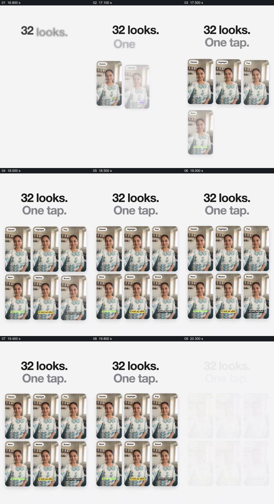

# 把同一段人物视频并排复制，让字幕差异成为比较对象

- 作品：案例 006，手机字幕编辑工具展示（库内案例）。
- 原片范围：16.700–20.500 秒；[完整原片](../video.mp4)｜[本卡片段](c02.mp4)。范围含起点、不含终点；末尾以原文件流长度为准。
- 观察方式与未确认范围：查看整片 64 帧总览和本卡九宫格；未独立完成原速连续观看或听审，采样间的运动、停顿、声音和同步未确认。以下创意价值是依据画面作出的分析，新题材迁移尚未实测。

## 原画面具体怎样设计

约 16.7 秒，深色时间线画面让位于浅色背景；上方黑字写“32 looks.”，灰色副标题是“One tap.”。第一个竖屏小窗口出现后，相同人物、厨房背景和相近取景的小预览逐步填成三列两行；每格左上有 Classic、Highlight、Pop、Neon、Marker、Boxed 等样式标签，字幕位于人物画面下方。

六格形成后同时留在一屏：人物、光线与环境基本一致，差别主要落在字幕颜色、字框或背景上。标题与集合上下分区，观众既看见片中宣称有 32 种外观，也能在画面内实际比较其中六个示例。约 20.3 秒整组退淡，接入下一段关于目标语言的内容。

## 为什么这样设计，好在哪里

因为主体与背景重复出现，观众不用在不同人物或不同镜头之间重新建立参照，更容易把注意力放到字幕样式本身；样式名贴近每个小窗，也让外观与名称一一对应。六项同时显示，完成了横向比较，而不只是快速逐个闪过。

这张卡强调的是“保持内容一致以比较处理差异”，32 是原片标题中的说法，本画面仅能看见六个示例；不同帧无法证明六段预览完全同步。

## 可直接使用的创意指令

当同一素材存在多种真实可呈现的处理方式，先选一个共同主体及相同或足够接近的内容范围，让差异集中在要比较的属性。把各结果放入相近尺寸的独立窗口，并将准确的名称或条件贴近各自对象；通过逐步补齐或其他清楚的方式形成集合，最后让多个结果同时留出辨认时间。

主体、窗口数量、字幕形式和颜色可按任务调整；必须保持比较基准与被比较变量清楚。若某一种样式遮挡主要内容或无法提供同一时刻的预览，应调整展示，避免把不可比较的画面包装为同条件结果。
