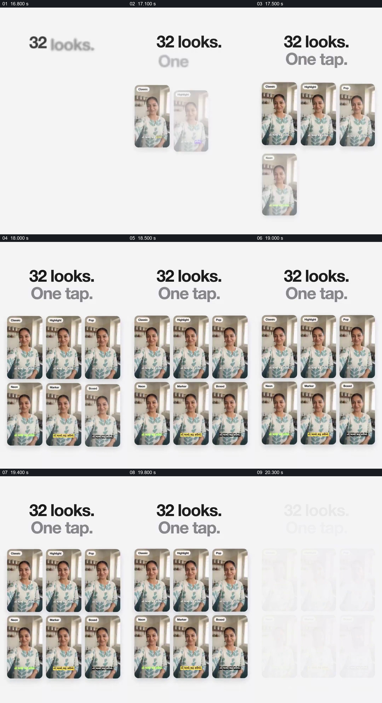

# 把同一视频的字幕样式并排，突出可比较差别

- 作品：案例 006《手机中的人物与数字人展示》（索引名称）。
- 原片范围：00:16.700–00:20.500，含起点、不含终点；[完整原片](../video.mp4)｜[本卡完整片段](c02.mp4)。
- 观察方式：按整片 64 宫格和约每秒一个原片帧观察全片，并选取下方九个源帧；未连续原速观看或听审，语言内容、字幕准确性及声音同步保持未知。

## 原画面具体怎样设计

浅色背景上的标题写“32 looks. One tap.”，一张人物竖屏预览先出现，随后扩展成两行三列的六张。六张均使用同一人物画面，标签分别标示 Classic、Highlight、Pop、Neon、Marker、Boxed，底部字幕的颜色、背景或强调方式有所区别。

## 为什么这样设计，好在哪里

主体画面保持一致，变化集中在字幕外观，使六种示例容易作为一组比较。标题宣称有 32 种样式，但本段可见的是六个预览，画面本身不能证明其他样式或实际的一键操作。 这是基于画面的作品分析，不代表作者自述或已测量的观众反应。

## 可直接使用的创意指令

当需要比较样式而不是比较内容本身时，选取同一个清楚的视频片段，分别生成真实可用的若干样式；以相近大小并列，保留相同的字幕位置和可读文字，让颜色、背景及强调方式的差别可见。样式总数和切换方式按实际能力说明，预览应足够大并留出阅读时间，不把未展示的方案视为已验证。
