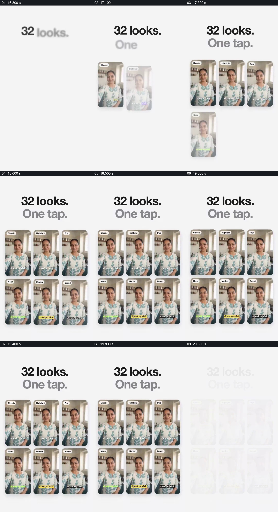

# 把同一段人物视频并排复制，让字幕差异成为比较对象

- 作品：案例 006，手机字幕编辑工具展示（库内案例）。
- 原片范围：16.700–20.500 秒；[完整原片](../video.mp4)｜[本卡片段](c02.mp4)。范围含起点、不含终点；末尾以原文件流长度为准。
- 观察方式与未确认范围：查看整片 64 帧总览和本卡九宫格；未独立完成原速连续观看或听审，采样间的运动、停顿、声音和同步未确认。以下创意价值是依据画面作出的分析，新题材迁移尚未实测。

## 原画面具体怎样设计

约 16.7 秒，深色时间线画面让位于浅色背景；上方黑字写“32 looks.”，灰色副标题是“One tap.”。第一个竖屏小窗口出现后，相同人物、厨房背景和相近取景的小预览逐步填成三列两行；每格左上有 Classic、Highlight、Pop、Neon、Marker、Boxed 等样式标签，字幕位于人物画面下方。

六格形成后同时留在一屏：人物、光线与环境基本一致，差别主要落在字幕颜色、字框或背景上。标题与集合上下分区，观众既看见片中宣称有 32 种外观，也能在画面内实际比较其中六个示例。约 20.3 秒整组退淡，接入下一段关于目标语言的内容。

## 为什么这样设计，好在哪里

因为主体与背景重复出现，观众不用在不同人物或不同镜头之间重新建立参照，更容易把注意力放到字幕样式本身；样式名贴近每个小窗，也让外观与名称一一对应。六项同时显示，完成了横向比较，而不只是快速逐个闪过。

这张卡强调的是“保持内容一致以比较处理差异”，32 是原片标题中的说法，本画面仅能看见六个示例；不同帧无法证明六段预览完全同步。

## 完整照排指令

以[完整原片](../video.mp4)的 16.7–20.5 秒为准。画幅 720×1280，源帧率 30/1。以下拍点为抽帧定位，位置按画幅百分比取近似值。

### 用料

- 【人物原片】沿用前一卡同一个人物同一条口播。备【样式名组】与【同句字幕】。用一个片段复制六份，人物取景、起帧与播放速度完全一致；用六组不同的字体、颜色、承托或描边处理同一行原文。样式并排时必须看得出哪项变化而保留同一参照。
- 【样式数量】【操作短句】【邻段主句】【邻段强调】【邻段字样】各备短字。若以画面中的总数代表实际功能，提供可打开的样式目录；六格只承担示例。

### 按源时刻摆放

1. **16.700–约 17.700 秒。** 竖幅浅灰白底，中轴上方用黑粗【样式数量】形成完整首行，下面灰粗【操作短句】同中心对齐。中下首先从左侧薄显第一条窄竖卡，再铺满首排三列。每格使用圆角，人物局部头顶到腰身尺寸一致。卡左上放小白胶囊【样式名组】，文字保持小于上部主标题。
2. **约 17.700–20.000 秒。** 第二排接在原位，下格与上格对齐，三列卡在画幅左右各留窄边，行间只数个像素等效。人物各窗已经建立后，从同一个源帧开始对齐播放或用同一个原始时间轴同步，字幕位于各自下部安全区。同名【同句字幕】同时可读，不同格用白字、荧光黄绿、黑描边等做比较。窗口建立后一直并排留到整体切换。备一段连续口播覆盖约 2.5 秒，禁止某格循环使口型或姿态脱开其他格；如果目的仅是并排读版式，允许六格共同定格在同一带字帧。
3. **约 20.000–20.500 秒。** 六窗撤出，浅底保留，中上换黑粗【邻段主句】，其下渐变【邻段强调】。邻段白样卡及【邻段字样】从靠中间位置开始显露。按 20.500 秒切出。独立采用样式对照时在六窗退场前结束。

### 局部采用

只够三套样式时，采用约 16.700–17.700 秒首排逻辑，增加读窗停顿并更新总数。只有单条无字幕片时，需补同一原句和另一样式才能比较。

### 验证状态

已对照原片每秒两帧画序并读回，核对同一人物的六格累积、画内字幕位及退到邻段的切出。各窗精确相位、快速切帧、原速听看和换料待核。
