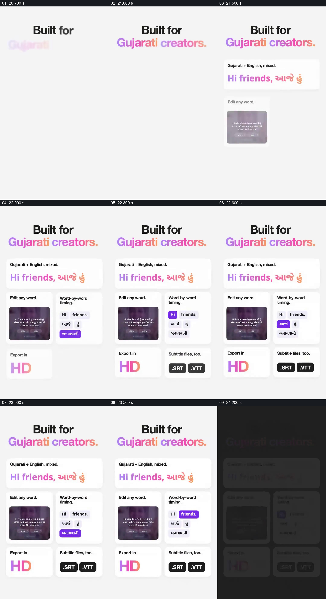

# 用目标语言样例和功能小卡说明面向谁

- 作品：案例 006《手机中的人物与数字人展示》（索引名称）。
- 原片范围：00:20.500–00:24.500，含起点、不含终点；[完整原片](../video.mp4)｜[本卡完整片段](c03.mp4)。
- 观察方式：按整片 64 宫格和约每秒一个原片帧观察全片，并选取下方九个源帧；未连续原速观看或听审，语言内容、字幕准确性及声音同步保持未知。

## 原画面具体怎样设计

浅色底上标题写“Built for Gujarati creators.”，下方依次出现古吉拉特语与英语混合的一行示例、编辑任意词语的小卡、逐词时序的小卡，以及 HD、SRT 和 VTT 的导出标签。各卡在同一屏中保持，形成产品用途概览。

## 为什么这样设计，好在哪里

目标人群先出现，后面的语言样例和功能卡直接为这一定位提供可见内容；不同小卡将编辑、对齐和导出分开，使观众知道宣传涉及哪些环节。具体语言识别能力、格式支持与示例文字准确性未独立核实。 这是基于画面的作品分析，不代表作者自述或已测量的观众反应。

## 可直接使用的创意指令

当产品为某一语言或人群提供工具时，先明确使用者，再准备真实且经该语言核对的短样例；将最重要的操作、时序或输出能力分别对应到可辨认的界面与结果。功能名称、格式及适用范围应以现有产品证据为准；若字幕由多语言组成，按实际语句和来源复核，不以混合文字外观证明识别准确。
