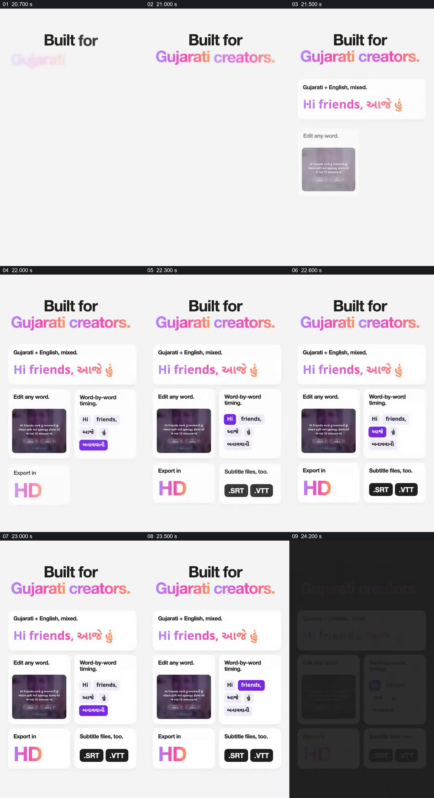

# 把目标语言样例置于中心，再以小卡说明相关能力

- 作品：案例 006，手机字幕编辑工具展示（库内案例）。
- 原片范围：20.500–24.500 秒；[完整原片](../video.mp4)｜[本卡片段](c03.mp4)。范围含起点、不含终点；末尾以原文件流长度为准。
- 观察方式与未确认范围：查看整片 64 帧总览和本卡九宫格；未独立完成原速连续观看或听审，采样间的运动、停顿、声音和同步未确认。以下创意价值是依据画面作出的分析，新题材迁移尚未实测。

## 原画面具体怎样设计

浅色背景上方先出现“Built for Gujarati creators.”，其中目标人群使用紫粉到橙色的渐变。其下先有一张横向白卡，以英文与古吉拉特文字混排的“Hi friends, …”作为大号样例，卡片上方说明两种语言混用。

接着下方出现两列小卡：一组是“Edit any word.”和编辑界面示例，另一组是“Word-by-word timing.”及由词块组成的小句，紫色突出其中一词；再往下分别是“Export in HD”和“SRT / VTT”格式卡。标题、混合语言样句和功能卡按从上到下的层级保留在同一浅色空间中。

## 为什么这样设计，好在哪里

标题首先明确这项展示面向谁；实际混合句子比只写“支持多语言”更具体，观众可以看到两种文字如何放在一行。下方功能卡把修改、词块、画面导出与字幕文件分成不同的小对象，与上面的语言样例保持同一屏关系，既呈现共同主题，也让用途各自可辨。

这是对画面组织方式的分析。截图没有验证古吉拉特语识别、词级时间精度或导出格式的真实实现；样句和功能名称只作为片中的展示。

## 完整照排指令

以[完整原片](../video.mp4)的 20.5–24.5 秒为准。画幅 720×1280，源帧率 30/1。以下拍点为抽帧定位，位置按画幅百分比取近似值。

### 用料

- 【受众首行】【受众次行】各一短行，【语言样例题】【混语原句】使用该受众实际认识的表达，混语两部分合成一个完整句。保留词序和实际字形，选支持所需文字的字款。
- 【改字标题】【改字界面】【词级标题】【词级用例】【分辨率标题】【分辨率字样】【字幕文件标题】【字幕格式组】对应编辑、逐字时序、画质和文件格式。改字预览用能印证该能力的实际截帧。词级例句尽量沿用【混语原句】开头，按实际时序标定高亮片。真实功能和格式附可打开的说明或导出样本。
- 【邻段导出词】【邻段手机预览】供结尾承接，使用同一个作品或同一示例项目的导出画面。

### 按源时刻摆放

1. **20.500–约 21.500 秒。** 竖幅浅灰白底。顶部约 y10% 居中黑粗【受众首行】，次行跟从轻虚到清，以等量级紫粉橙渐变排【受众次行】。下方约 x6%–94%、y28%–44% 放宽白卡，左上用小黑【语言样例题】，其下以明显更大的渐变【混语原句】左齐。宽卡先于功能网格建立。
2. **约 21.500–22.500 秒。** 宽白卡原位保留。其下加两列等宽白卡，暗缝保持窄。左卡上方黑小粗【改字标题】，下方深紫色方窗【改字界面】；右卡上方两行【词级标题】，下方用短词块分行排【词级用例】，用紫底反白突出当前词。再补底行两卡：左卡小黑【分辨率标题】上置，下面用大渐变【分辨率字样】；右卡小黑【字幕文件标题】上置，下方并排黑底反白圆角【字幕格式组】。底行浅卡与第二行对齐，上下层之间只留细灰缝。
3. **约 22.500–23.700 秒。** 保留顶部标题、宽语言卡及四张能力卡的完整阅读状态。编辑窗从入场一直留到整组退场。原片抽帧可辨的是稳定界面样张，换料可用静态示意；加入动态演示时，仅在卡框内播放约两秒的连续操作，不循环误显示已撤销状态。词级高亮留在例句实际词块上，禁用独立浮标。
4. **约 23.700–24.500 秒。** 全排退暗，黑底入场。靠左上先露白色粗【邻段导出词】；竖向【邻段手机预览】在中部出现，紫色界面与白底人物影像有清楚边界。按 24.500 秒切出。只采用语言与能力对照时，在黑底第一幅以前结束。

### 局部采用

只有语言例句时可用约 20.500–21.500 秒并延长读留。能力卡若只有其中两项，使用 21.500 秒起的第一排构图，可截去底行演出，但须保留与语言样例的关系。

### 验证状态

已对照原片每秒两帧画序并读回正文，核对先建目标人群与混语原句、两排小卡依次积累，以及浅色卡组切至黑底手机。各卡准确进场帧、原速听看与换料试摆待核。
