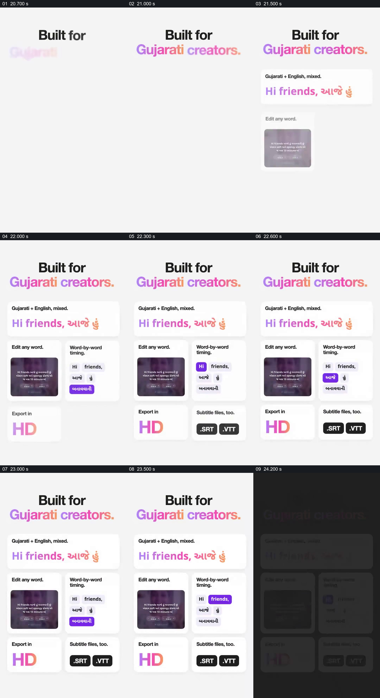

# 把目标语言样例置于中心，再以小卡说明相关能力

- 作品：案例 006，手机字幕编辑工具展示（库内案例）。
- 原片范围：20.500–24.500 秒；[完整原片](../video.mp4)｜[本卡片段](c03.mp4)。范围含起点、不含终点；末尾以原文件流长度为准。
- 观察方式与未确认范围：查看整片 64 帧总览和本卡九宫格；未独立完成原速连续观看或听审，采样间的运动、停顿、声音和同步未确认。以下创意价值是依据画面作出的分析，新题材迁移尚未实测。

## 原画面具体怎样设计

浅色背景上方先出现“Built for Gujarati creators.”，其中目标人群使用紫粉到橙色的渐变。其下先有一张横向白卡，以英文与古吉拉特文字混排的“Hi friends, …”作为大号样例，卡片上方说明两种语言混用。

接着下方出现两列小卡：一组是“Edit any word.”和编辑界面示例，另一组是“Word-by-word timing.”及由词块组成的小句，紫色突出其中一词；再往下分别是“Export in HD”和“SRT / VTT”格式卡。标题、混合语言样句和功能卡按从上到下的层级保留在同一浅色空间中。

## 为什么这样设计，好在哪里

标题首先明确这项展示面向谁；实际混合句子比只写“支持多语言”更具体，观众可以看到两种文字如何放在一行。下方功能卡把修改、词块、画面导出与字幕文件分成不同的小对象，与上面的语言样例保持同一屏关系，既呈现共同主题，也让用途各自可辨。

这是对画面组织方式的分析。截图没有验证古吉拉特语识别、词级时间精度或导出格式的真实实现；样句和功能名称只作为片中的展示。

## 可直接使用的创意指令

当内容针对特定群体或材料时，先用清楚的标题点明对象，再选一份该群体真正会遇到的可读样例放到主要区域。围绕这份样例安排少量功能或处理结果，每项同时给名称和小型可视对象，使人能够判断它与示例有什么关系。

群体、语言、颜色和卡片布局可以变化，但样例应是真实、准确且能够说明需求的内容；卡片不要只是并列图标。需要证明识别或处理能力时，附可核实的原始输入、结果及必要条件，不把视觉示意视为实测。
