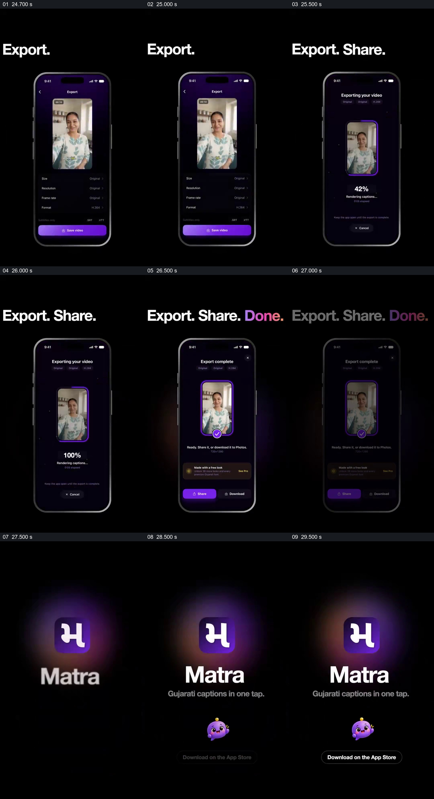

# 把导出设置、进度和完成状态连成可见流程

- 作品：案例 006《手机中的人物与数字人展示》（索引名称）。
- 原片范围：00:24.500–00:30.070，含起点、不含终点；[完整原片](../video.mp4)｜[本卡完整片段](c04.mp4)。
- 观察方式：按整片 64 宫格和约每秒一个原片帧观察全片，并选取下方九个源帧；未连续原速观看或听审，语言内容、字幕准确性及声音同步保持未知。

## 原画面具体怎样设计

黑底上出现手机导出页面，标题先写 Export，再补成 Export. Share.；手机内从视频和设置进入导出进度，百分比增长至 100%。随后页面显示导出完成、分享与下载选项，标题补成 Done；最后回到 Matra 标识和应用商店下载提示。

## 为什么这样设计，好在哪里

同一手机与同一人物预览贯穿设置、进度和完成三个状态，观众能够把抽象的导出动作与一个具体结果联系起来。原片画面是展示界面，进度与完成文字不能单独证明文件已经实际导出或入口仍可用。 这是基于画面的作品分析，不代表作者自述或已测量的观众反应。

## 可直接使用的创意指令

当需要说明一个处理或导出流程时，先展示实际输入和关键设置，让同一内容在处理中保持可辨；再显示真实进度或明确标注的示意状态，最后展示可验证的结果与下一步入口。不要用 100% 动画替代文件检查；导出格式、分享功能和可用链接应按实际产品确认。
