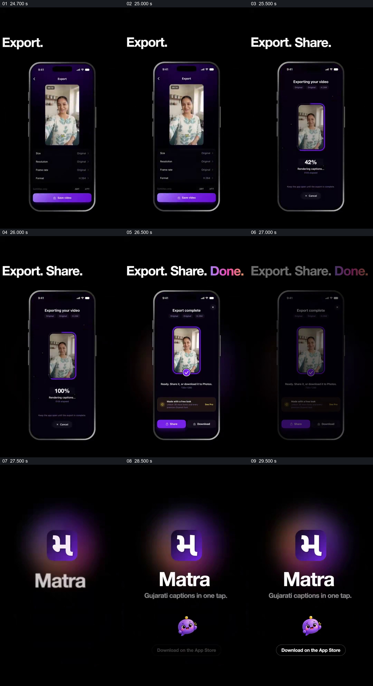

# 让同一段作品留在手机中，看见从导出到完成

- 作品：案例 006，手机字幕编辑工具展示（库内案例）。
- 原片范围：24.500–30.070 秒；[完整原片](../video.mp4)｜[本卡片段](c04.mp4)。范围含起点、不含终点；末尾以原文件流长度为准。
- 观察方式与未确认范围：查看整片 64 帧总览和本卡九宫格；未独立完成原速连续观看或听审，采样间的运动、停顿、声音和同步未确认。以下创意价值是依据画面作出的分析，新题材迁移尚未实测。

## 原画面具体怎样设计

约 24.5 秒，竖屏黑底中央是一部手机，屏内保留此前女性人物视频；视频下方显示尺寸、分辨率、帧率和格式等设置，底部是紫色“Save video”按钮。手机外上方标题从“Export.”扩展为“Export. Share.”。

之后手机中的大幅人物预览缩为较小作品框，外缘出现紫色描边，状态文字改为“Exporting your video”，下方百分比从中间状态显示到 100%。随后界面显示“Export complete”、勾选图标和 Share、Download 按钮；外部标题补上渐变色“Done.”。人物预览一直作为同一个待交付作品的识别参照，最后手机和标题让位给图标、品牌名及下载入口。

## 为什么这样设计，好在哪里

从导出设置到完成状态都置于同一部手机里，作品缩略图也持续可见，观众可以把进度与刚刚看到的人物视频联系起来。外部三个短词分别配合界面阶段出现，标题提供阅读方向，内部界面则给出具体状态，二者承担不同职责。

最后把操作完成与品牌入口分开，可以让结果先成为可见状态，再将注意力交到下一步。百分比及完成提示只是影片中的产品演示，不证明实际任务完成，也不能据此判断真实导出速度。

## 可直接使用的创意指令

当流程需要交代具体内容如何变成可交付结果时，先显示可辨认的作品和关键设置，再让同一作品以缩略图或其他稳定标识留在处理中和完成状态。将状态变化、进度和可执行的下一步分别放在清楚的位置，最后让完成结果先成立，再接产品或行动入口。

载体可以是手机、网页、实体包装或其他实际输出环境；改变画幅与颜色不影响方法，关键是作品身份持续可追踪，等待与完成有可区分的状态。进度和完成声明必须来自真实任务，不能让模拟百分比冒充实际导出。
