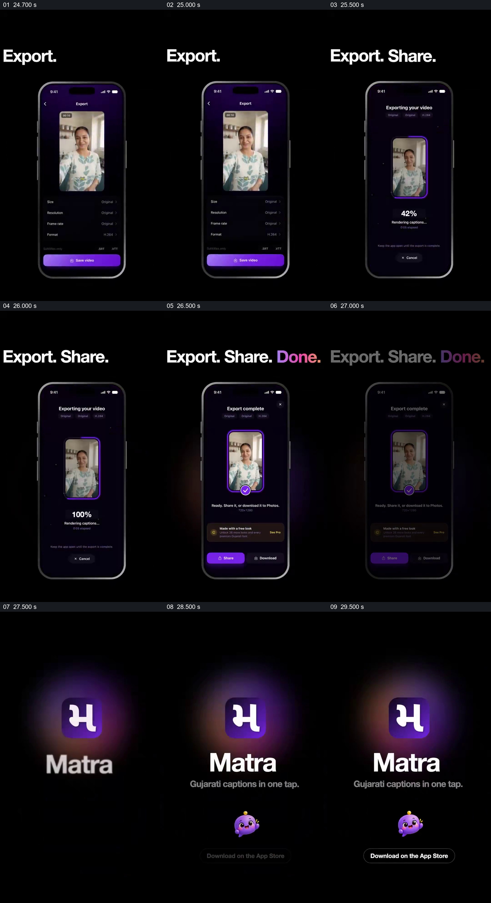

# 让同一段作品留在手机中，看见从导出到完成

- 作品：案例 006，手机字幕编辑工具展示（库内案例）。
- 原片范围：24.500–30.070 秒；[完整原片](../video.mp4)｜[本卡片段](c04.mp4)。范围含起点、不含终点；末尾以原文件流长度为准。
- 观察方式与未确认范围：查看整片 64 帧总览和本卡九宫格；未独立完成原速连续观看或听审，采样间的运动、停顿、声音和同步未确认。以下创意价值是依据画面作出的分析，新题材迁移尚未实测。

## 原画面具体怎样设计

约 24.5 秒，竖屏黑底中央是一部手机，屏内保留此前女性人物视频；视频下方显示尺寸、分辨率、帧率和格式等设置，底部是紫色“Save video”按钮。手机外上方标题从“Export.”扩展为“Export. Share.”。

之后手机中的大幅人物预览缩为较小作品框，外缘出现紫色描边，状态文字改为“Exporting your video”，下方百分比从中间状态显示到 100%。随后界面显示“Export complete”、勾选图标和 Share、Download 按钮；外部标题补上渐变色“Done.”。人物预览一直作为同一个待交付作品的识别参照，最后手机和标题让位给图标、品牌名及下载入口。

## 为什么这样设计，好在哪里

从导出设置到完成状态都置于同一部手机里，作品缩略图也持续可见，观众可以把进度与刚刚看到的人物视频联系起来。外部三个短词分别配合界面阶段出现，标题提供阅读方向，内部界面则给出具体状态，二者承担不同职责。

最后把操作完成与品牌入口分开，可以让结果先成为可见状态，再将注意力交到下一步。百分比及完成提示只是影片中的产品演示，不证明实际任务完成，也不能据此判断真实导出速度。

## 完整照排指令

以[完整原片](../video.mp4)的 24.5–30.07 秒为准。画幅 720×1280，源帧率 30/1。以下拍点为抽帧定位，位置按画幅百分比取近似值。

### 用料

【作品预览】用前卡的同一个竖版成品及封面，准备其同次导出的【设置字段】【导出进度】【完成文案】【分享按钮】【下载按钮】。备三个短【步骤字】及【片尾图标】【片尾品牌】【片尾副句】【片尾下载入口】。声称已完成的演示提供对应导出文件或操作记录。

### 按源时刻摆放

1. **24.500–约 25.000 秒。** 竖幅纯黑底。左上黑底反白粗体【步骤字】先出首词。手机银暗细框位于中轴，约占画宽五成，内屏近黑带紫。上半居中【作品预览】，其下小灰白【设置字段】对齐排列，底边为亮紫按钮。
2. **约 25.000–26.800 秒。** 手机外框和位置保持；内页改黑色进度页，同一【作品预览】缩小到中心，上下有状态标题和居中大号白【导出进度】，从少量快速升到临近满值。上部【步骤字】同时增加第二词。进度页再变完成页，原片预览有亮紫环或勾，【完成文案】居中收稳，底部保留左右两个按钮，亮紫【分享按钮】在左，暗底【下载按钮】在右。上部第三个【步骤字】用紫橙渐变。可以用同一静态封面做进度与完成的两个状态；动态成品播到整个手机离场，状态切换时保持内容和时钟，不循环假造完成。
3. **约 26.800–30.070 秒。** 手机和步骤字全退。黑底中轴立带紫橙晕光的【片尾图标】，下方白粗【片尾品牌】及更细灰白【片尾副句】。稍后在其下放小紫吉祥物，底端附近用暗胶囊包白色【片尾下载入口】。整组近中轴保持至片尾截出。

### 局部采用

可单取约 24.500–26.800 秒的导出状态演出，须提供同一作品的设置、进度与结果。只用片尾可从约 26.800 秒起。

### 验证状态

已用每秒两帧原片画序核对并读回，检查同一画面跨状态保留、完成按钮显露及黑底品牌切出。精确帧、原速听看和换料待核。
