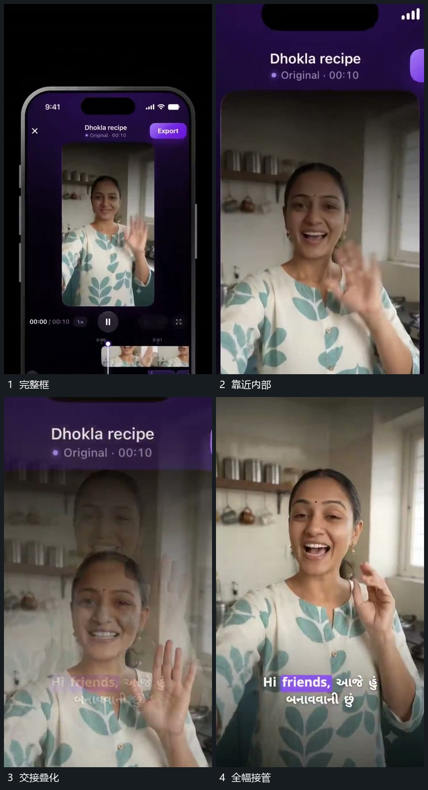

# 推近竖框内部，活动画面接管全幅

## 运动指令

向竖框内部靠近，外边缘越出，活动图像逐渐成为全幅。交接期间存在叠化，完成后旧边界不再限制内容，活动保持继续。

## 视频切片

[播放本机制的原片切片](m02.mp4)

覆盖分镜中“完整框”至“全幅接管”的连续过程，并保留邻近的前后衔接画面；原片中交叠发生的动作一并保留。

## 分镜过程

## 组合与调整

借鉴位置与内容对应，不认定整个框被真实几何变形成素材；扩大中心由新片重定。
