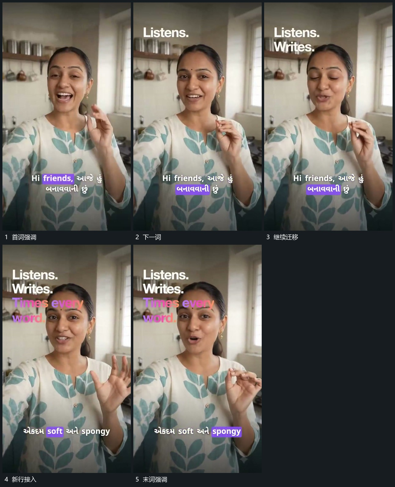

# 固定字组内强调块逐项迁移

## 运动指令

保持字组的整体位置，让小强调块逐项转移到不同词位，前一词恢复普通状态。整组内容更新后继续同样顺序，主活动画面在后层持续。

## 视频切片

[播放本机制的原片切片](m03.mp4)

覆盖分镜中“首词强调”至“末词强调”的连续过程，并保留邻近的前后衔接画面；原片中交叠发生的动作一并保留。

## 分镜过程

## 组合与调整

强调顺序按新片内容决定，不继承原语音时码；保持每次只有当前重点明显。
