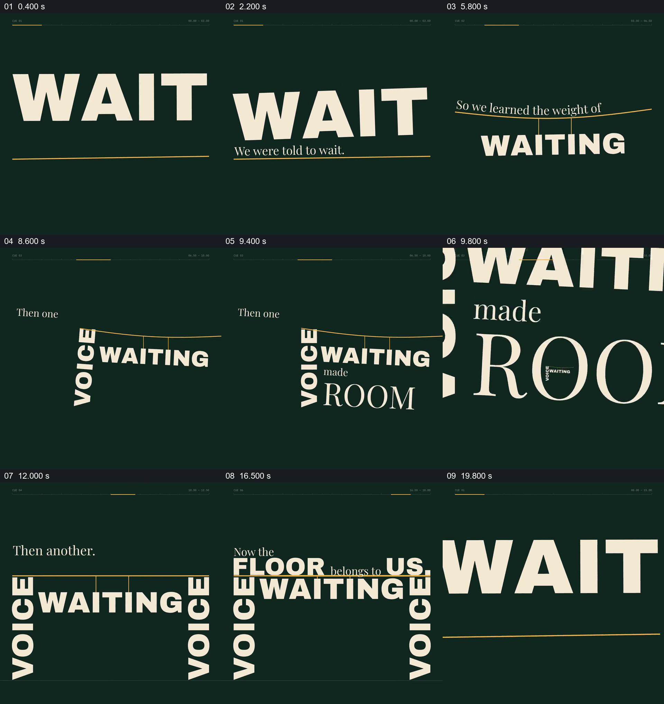

# 让“等待”悬在线下，再用两个声音撑出空间

- 作品：案例 118。
- 原片范围：00:00.000–00:20.000（源时间，含起点、不含终点）；[完整原片](../video.mp4)｜[本卡片段](../video.mp4)。复用完整原片和同范围分镜。
- 观察方式与未确认范围：核看全片 64 帧总览和本卡九宫格；原片无音轨；未独立连续原速观看，抽帧间运动和精确节奏未确认。价值判断为作品分析，跨项目迁移尚未实测。

## 原画面具体怎样设计

深绿色方形画面上，大号浅色“WAIT”压在中央，下方一条黄线横贯画面；小字逐渐补成“We were told to wait.”。随后大字让位，句子变为“So we learned the weight of”，粗体“WAITING”出现在黄线下方。细短竖线将字和黄线连接，线的中央下弯；词语既可以阅读，也像悬挂的重量。

“Then one”出现后，“VOICE”先位于左侧，再以竖向靠在黄线左端；WAITING 仍留在线下。“made ROOM”出现，ROOM 放大后，其 O 形开口内仍可看见先前的小结构，下一组画面又回到原先的线和文字。

“Then another.”引出右侧第二个竖向 VOICE，两侧词语像支柱，黄色横线在源帧中从弯曲趋于接近平直，WAITING 仍在中间。上方逐渐补出“Now the FLOOR belongs to US.”，文字和线形成有两侧支撑的空间；片尾字形放大、经过浅色遮盖，又出现接近开头的 WAIT 与黄线。

## 为什么这样设计，好在哪里

等待没有被另画成抽象重物，而是让文字本身挂在线上；两次 VOICE 的位置变化分别改变这条线的支撑关系，观众能同时阅读句子和看见它的空间比喻。ROOM 放大时保留旧结构作为内部参照，再回到悬挂构图，避免将“空间”仅写成一个形容词。

支撑与重量是视觉隐喻的分析，不是对现实因果的证明；原片无音轨，无法推断音乐或语气。

## 完整照排指令

以[完整原片](../video.mp4)的 0–20 秒为准。画幅 1080×1080，源帧率 60/1。以下拍点为抽帧定位，位置按画幅百分比取近似值。

### 源时刻照排

- 0–约 5 秒，深绿方幅，正中偏上用米白超粗无衬线【等待大字】压住视觉中心，细黄【承重线】横贯其下缘。线左端上方用浅色衬线小字逐步补齐【开场原句】。
- 约 5–8 秒，大字让位，线左上换同样细衬线【重量引句】，线下挂大号【重量词】，两条细竖线将字块与黄线连起。黄线中心下弯，挂字居中并保持可读。
- 约 8–11 秒，左上换【第一声引句】，左侧【支撑词】先平排，再转为竖向顶在黄线左端。重量词保持悬挂。放大【空间词】的圆形开口，让前一结构从洞中仍可见，再回到原构图。
- 约 11–18 秒，换【第二声引句】，在右侧立第二个【支撑词】，黄线逐渐拉平。上方混排大号粗体与细衬线【归属结句】，两根支柱与中央挂字同屏保留。
- 约 18–20 秒，放大米白字形，使浅色块遮住画面，落回接近开场的大字与黄线位置，于开场构图回现处结束。

### 用料与取用

【等待大字】【开场原句】【重量引句】【重量词】【第一声引句】【空间词】【第二声引句】【归属结句】交一套能用重量、支点、开口表达同一意思的文字。两个【支撑词】须是同名词且同字重，按相反边界定位；【空间词】需有可放大为遮罩的字腔。【承重线】自开场至约 18 秒持续，同一条线由平直转下弯、加一侧支点、加双侧支点后拉平；洞内仍使用前一组合，不另造位置。文字图层可静置以供阅读，结构变化一次演完，禁循环、定格和照片运镜顶替形变，片尾复现是单次回扣。只有重量隐喻时可取约 5–8 秒；只有两侧支撑关系时可取约 11–18 秒，入点先明示已有左支点和挂字。

### 验证状态

已对照原片等距抽帧与卡稿，核对黄线、挂字、先左后右的支柱及结尾遮幅。字腔过门、线的逐帧复位和原速听看待核，未实际换料试摆。
