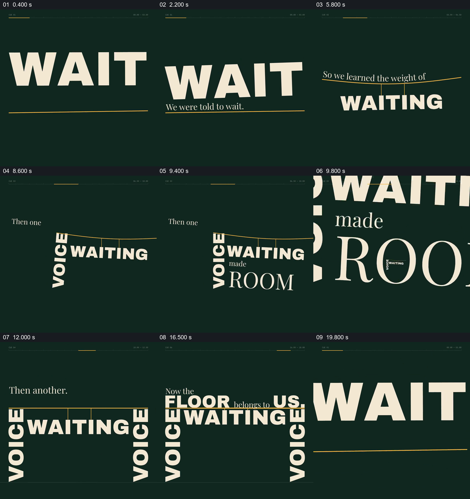

# 让等待成为悬挂的重量，让声音成为支撑

- 作品：案例 118《字形构成建筑与支撑》（索引名称）。
- 原片范围：00:00.000–00:20.000，含起点、不含终点；[完整原片及本卡片段](../video.mp4)。本卡覆盖整片，直接共用原文件。
- 观察方式：按原片 64 宫格和约每秒一次的原片抽帧观察整片，另核看下方九个源帧；未连续原速观看。媒体探测显示此原片没有音轨，因此没有可听审的原声。

## 原画面具体怎样设计

深绿色底上先出现巨大的 WAIT 和一条细黄线，较小的句子逐步补成“We were told to wait.”。随后句子改为“So we learned the weight of”，粗体 WAITING 从黄线下方显出，细线向下弯曲，短竖线把这个词连接到线上，使它看上去像被悬挂的重量。

“Then one”出现后，VOICE 从左侧进入并转成竖向，顶住弯曲黄线的一端；WAITING 仍挂在线下。文字补出“made ROOM”，ROOM 放大，原有文字结构在放大的 O 形内部继续可见；视野再进入该开口，原结构重新占据画面。接着“Then another.”引出第二个竖向 VOICE，从另一侧支住黄线，原先下弯的线逐渐接近平直。

线的上方依次出现“Now the FLOOR belongs to US.”，两侧 VOICE 和中间 WAITING 仍在，文字共同组成一个有支柱和横线的空间。末尾字形放大、画面经过浅色覆盖，再回到 WAIT 和黄线的开头状态。

## 为什么这样设计，好在哪里

文字不只负责说出“等待有重量”：WAITING 通过细线与下弯的横线发生位置关系，重量被转成可见的场面。两个 VOICE 分别成为支撑，第二个出现后横线趋于平直，使“一个声音、再一个声音”的前后差异具有直观的结构变化。ROOM 的字腔同时承担词义与进入下一画面的入口；后面的 FLOOR 和 US 则落在已经建立的结构上，让结尾与前面的支撑过程有直接关系。

这里的负重与支撑是排印比喻，并非对现实物理过程的证明。以上是基于作品的设计分析，不代表作者自述或已测量的观众反应。

## 可直接使用的创意指令

当内容中的几个短词确实存在负担、支持或共同创造空间的关系，且观众能够读懂这些词时，先让关键词作为文字被识别，再用同一批字形构成与词义一致的空间：将表示负担的词连接到可见的横线或承载物，让其状态表现压力；让表示支持的词进入并真正接触承载处，保留原有负担，随后用另一项支持改变整体状态。若内容涉及空间的形成，可把适合的字腔或独立容器变成观察入口，让进入后的画面延续原结构，再把结论放在已建立的支撑关系上。词语、字体、方向和具体空间按新文案调整；字形并不适合形成清楚开口时，可以另用容器承担入口。先保证阅读和语义关系成立，视觉结构作为比喻，不能替代事实论证。
